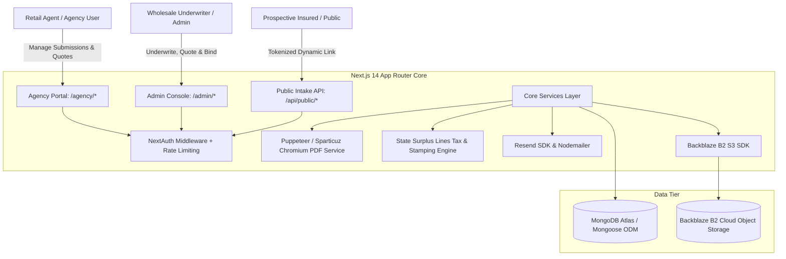

# Sterling Wholesale Insurance Portal — Complete Technical & Operational Documentation

> **Platform**: Sterling Wholesale Insurance Portal  
> **Repository**: [eliteoperationglobal/sterling](https://github.com/eliteoperationglobal/sterling)  
> **Architecture**: Next.js 14 App Router · TypeScript · MongoDB · Tailwind CSS · NextAuth.js  
> **Target Jurisdiction**: Commercial Lines Wholesale Brokerage (US Surplus Lines & Admitted Markets)  
> **Last Updated**: November 2026  

---

## Table of Contents
1. [Executive Overview](#1-executive-overview)
2. [Technology Stack & System Architecture](#2-technology-stack--system-architecture)
3. [Supported Commercial Lines & Program Intake](#3-supported-commercial-lines--program-intake)
4. [Prerequisites & Local Development Setup](#4-prerequisites--local-development-setup)
5. [Environment Variables Reference](#5-environment-variables-reference)
6. [Database Seeding & Test Accounts](#6-database-seeding--test-accounts)
7. [User Roles & Access Control (RBAC)](#7-user-roles--access-control-rbac)
8. [End-to-End Operational Lifecycle](#8-end-to-end-operational-lifecycle)
9. [PDF Generation Engine & Document Pipeline](#9-pdf-generation-engine--document-pipeline)
10. [State Surplus Lines Tax & Stamping Fee Engine](#10-state-surplus-lines-tax--stamping-fee-engine)
11. [Premium Financing Engine](#11-premium-financing-engine)
12. [Core API Directory](#12-core-api-directory)
13. [Deployment Guide (Vercel, Docker, Self-Hosted)](#13-deployment-guide)
14. [Troubleshooting & FAQs](#14-troubleshooting--faqs)

---

## 1. Executive Overview

The **Sterling Wholesale Insurance Portal** is an enterprise-grade wholesale insurance brokerage management platform. It streamlines and automates the entire lifecycle of specialty commercial property & casualty (P&C) insurance risks:

- **Retail Agency Portal**: Agencies submit commercial risks, track underwriting progress, configure broker fees, download binding proposals, initiate e-signatures, and request policy binding.
- **Underwriting Admin Console**: Wholesale underwriters review incoming applications, route submissions to carrier markets, input multi-carrier terms, calculate state surplus lines taxes and stamping fees, issue formal proposals, approve binds, and manage policy audits.
- **Public Intake Engine**: Retail agents can generate secure, tokenized single-use application links to allow end-insured clients to fill out application forms directly.
- **Integrated Financing & Payments**: Dynamic EMI calculator with premium finance agreement generation, credit card/ACH payment authorization, and down-payment capture.
- **Document Generation Engine**: High-fidelity PDF generation for ACORD 125/126 applications, formal carrier quote proposals, invoices, payment authorizations, and policy binders.

---

## 2. Technology Stack & System Architecture



### Core Technologies
| Category | Technology | Version | Purpose |
|---|---|---|---|
| **Framework** | Next.js (App Router) | 14.2.x | React Server Components, Server Actions, API Route Handlers |
| **Language** | TypeScript | 5.x | End-to-end type safety |
| **Database** | MongoDB (Mongoose) | 8.3.x | Document database for polymorphic submissions, quotes & policies |
| **Auth** | NextAuth.js | 4.24.x | JWT session strategy, credentials provider, role-based middleware |
| **Styling** | Tailwind CSS | 3.4.x | Utility-first responsive design & custom components |
| **Cloud Storage** | Backblaze B2 / AWS S3 SDK | 3.1000.x | Secure file uploads (loss runs, applications, binders, invoices) |
| **PDF Generation** | Puppeteer & Sparticuz Chromium | 24.x / 131.x | Server-side pixel-perfect PDF document & proposal rendering |
| **Transactional Mail**| Resend / Nodemailer | 6.x / 7.x | Automated 2FA OTP codes, quote alerts, and bind confirmations |
| **Validation** | Zod + React Hook Form | 3.25.x | Robust form state management and input schema validation |

---

## 3. Supported Commercial Lines & Program Intake

The portal supports specialized underwriting programs with custom dynamic intake schemas, rating models, and policy forms:

1. **Builders Risk**
   - Ground-up construction, renovations, and remodeling
   - Coverage inputs: Limit per Occurrence, Completed Value, Total Insurable Value, Existing Structure, Valuation (ACV / Replacement Cost), Coinsurance
   - Sublimits: Water Damage, Soft Costs, Delay in Completion, Property in Transit, Temporary Offsite Storage, Debris Removal, Pollutant Clean-up, Scaffolding, Fire Dept Service Charge
   - Deductibles & Values: All-Perils Deductible, Fire Deductible, Building Value

2. **Contractors Equipment (Inland Marine)**
   - Scheduled equipment, unscheduled tools, employee tools, rented/leased equipment
   - Deductible selections, replacement cost vs. actual cash value, territorial limitations

3. **Manufacturers**
   - Commercial General Liability (CGL)
   - Products & Completed Operations liability
   - Property, Business Personal Property (BPP), and Equipment Breakdown
   - Independent options for Professional Liability & Pollution Liability

4. **Apartment Buildings / Habitational**
   - Building limits, Business Income / Extra Expense, Building Ordinance & Law
   - Multi-unit habitational questionnaire (smoke detectors, wiring, plumbing, roof age)

5. **Commercial Property & General Liability**
   - Retail, wholesale, office, light industrial
   - ISO class codes, gross receipts, employee payroll, subcontractor costs

---

## 4. Prerequisites & Local Development Setup

### System Prerequisites
- **Node.js**: v18.17.0 or v20.x (LTS recommended)
- **Package Manager**: `npm` (v9 or v10)
- **MongoDB**: Active MongoDB Atlas cluster or local MongoDB instance (v6.0+)
- **Git**: Installed and configured

### Installation Steps

1. **Clone the repository**:
   ```bash
   git clone https://github.com/eliteoperationglobal/sterling.git
   cd sterling
   ```

2. **Install dependencies**:
   ```bash
   npm install
   ```

3. **Configure Environment Variables**:
   Copy the example environment configuration:
   ```bash
   cp .env.example .env.local
   ```
   Open `.env.local` and populate your MongoDB connection string and credentials (see [Section 5](#5-environment-variables-reference)).

4. **Seed Database with Initial Data**:
   Populate default carriers, form templates, underwriting routing rules, agencies, and admin accounts:
   ```bash
   npm run seed
   ```

5. **Start the Development Server**:
   ```bash
   npm run dev
   ```
   Open [http://localhost:3000](http://localhost:3000) in your browser.

---

## 5. Environment Variables Reference

| Variable | Required | Default / Format | Description |
|---|---|---|---|
| `MONGODB_URI` | **Yes** | `mongodb+srv://...` | MongoDB connection URI with read/write access. |
| `NEXTAUTH_URL` | **Yes** | `http://localhost:3000` | Canonical root URL for NextAuth session callbacks. |
| `NEXTAUTH_SECRET`| **Yes** | 32+ char hex / base64 | Secret key for NextAuth JWT encryption & signing. |
| `JWT_SECRET` | **Yes** | 32+ char hex / base64 | Secret key used for standalone token verification. |
| `NODE_ENV` | Optional | `development` / `production` | Node environment flag. |
| `B2_KEY_ID` | Optional | String | Backblaze B2 Application Key ID for S3 storage. |
| `B2_APPLICATION_KEY`| Optional | String | Backblaze B2 Application Key. |
| `B2_BUCKET_NAME` | Optional | `sterling-uploads` | S3 bucket name for policy documents. |
| `B2_REGION` | Optional | `us-west-004` | S3 / Backblaze region. |
| `B2_ENDPOINT` | Optional | `https://s3.us-west-004.backblazeb2.com` | S3 compatible API endpoint. |
| `RESEND_API_KEY` | Optional | `re_...` | Resend API key for transactional email delivery. |
| `EMAIL_FROM` | Optional | `noreply@sterlingwholesaleinsurance.com` | Default sender email for outgoing alerts. |
| `ENABLE_2FA` | Optional | `false` (`true` to enable) | Enforces email OTP 2FA for retail agency logins. |
| `SMARTY_AUTH_ID` | Optional | String | SmartyStreets address verification ID. |
| `SMARTY_AUTH_TOKEN`| Optional| String | SmartyStreets address verification token. |

---

## 6. Database Seeding & Test Accounts

The codebase provides automated TypeScript seed scripts located in `scripts/`:

```bash
# Main seed: populates all core models, agencies, underwriters, carriers, and forms
npm run seed

# Seed specific agency environments:
npm run seed:blueangel
npm run seed:patrickarias
```

### Pre-Configured Seed Accounts
| Portal | Role | Email | Password | Scope |
|---|---|---|---|---|
| **Admin Console** | `system_admin` | `admin@sterling.com` | `Admin123!` | Full underwriting & management |
| **Agency Portal** | `agency_admin` | `agent@gamaty.com` | `Agent123!` | Gamaty Insurance Agency (DBA Capital & Co) |
| **Agency Portal** | `agency_admin` | `agent@blueangel.com` | `Agent123!` | Blue Angel Insurance Services |

*(Passwords configured during local `npm run seed`; review `scripts/seedAll.ts` to adjust initial credentials)*

---

## 7. User Roles & Access Control (RBAC)

Access control is enforced at both the Edge middleware (`src/middleware.ts`) and API route levels:

1. **`system_admin`**:
   - Access to `/admin/*` routes and `/api/admin/*` endpoints.
   - Capabilities: Review all agency submissions, enter carrier terms, override taxes and stamping fees, generate proposals, approve/reject bind requests, issue policies, manage audits, and configure agency settings.

2. **`agency_admin`**:
   - Access to `/agency/*` routes and `/api/agency/*` endpoints.
   - Capabilities: Create submissions, invite and manage sub-agents/producers within their agency, add retail broker fees, approve quotes, generate insured links, execute e-signatures, and submit bind requests.

3. **`agency_user`**:
   - Producer access restricted to submissions created by or assigned to their account within the agency.

4. **Public / Unauthenticated**:
   - Access to `/apply/[token]` and `/api/public/*`.
   - Tokenized single-use links for prospect insured application completion without requiring an account.

---

## 8. End-to-End Operational Lifecycle

```
[1. Application Intake]
   ├── Retail Agent creates submission in /agency/quote/[programId]
   └── OR Prospect completes intake via /apply/[token]
        │
[2. Underwriter Review & Quote Entry]
   ├── Submission moves to 'quoted' status in /admin/submissions
   ├── Underwriter enters carrier terms (Kinsale, Richmond National, Lloyd's, etc.)
   ├── System calculates state taxes (e.g. CA 3% Surplus Lines Tax + 0.25% Stamping Fee)
   └── Quote is posted to the retail agency
        │
[3. Proposal Presentation]
   ├── Retail Agent adds broker fee (optional)
   ├── Agent downloads or previews official Proposal PDF
   └── Insured accepts coverage option
        │
[4. E-Signature & Payment]
   ├── Application packet, ACORD forms & payment auth generated
   ├── Insured & Agent e-sign documents
   └── Payment authorized (Full Pay, Down Payment, or Financed via EMI)
        │
[5. Bind Request & Issuance]
   ├── Retail Agent clicks 'Request Bind'
   ├── Underwriter validates subjectivities & payment confirmation
   ├── Underwriter clicks 'Approve & Issue Policy'
   └── Policy status changes to 'BOUND'; certificate/binder dispatched
        │
[6. Policy Service & Audits]
   └── System tracks endorsements, mid-term audits, and cancellation requests
```

---

## 9. PDF Generation Engine & Document Pipeline

All policy documents and proposals are generated server-side using Puppeteer and Sparticuz Chromium:

- **Location**: `src/lib/services/pdf/`
- **Primary Generators**:
  - `ProposalPDFHTML.ts`: Multi-policy and single-policy wholesale proposal document with coverage summaries, payment schedule, subjectivities, and terms.
  - `BuildersRiskPacketPDF.ts`: Builders risk quote & ACORD application packet with detailed property coverage limits.
  - `ManufacturersPacketPDF.ts`: Manufacturing commercial lines packet.
  - `ApartmentPacketPDF.ts`: Habitational apartment application packet.
  - `ApplicationPacketPDF.ts`: Universal commercial application packet.
  - `InvoicePDF`: Official wholesale premium and fee invoice.

### PDF Route Endpoints:
- `GET /api/admin/submissions/[id]/proposal`: Generates/streams proposal PDF for admin.
- `GET /api/agency/applications/[id]/proposal`: Generates/streams proposal PDF for agency.
- `GET /api/admin/submissions/[id]/pdf`: Full application packet PDF.

---

## 10. State Surplus Lines Tax & Stamping Fee Engine

Located in `src/lib/data/stateTaxRates.ts` and `src/app/api/tax/calculate/route.ts`:

- Automatically detects the insured risk state (prioritizing property/risk location over mailing address).
- Applies state-specific surplus lines tax rates (e.g., California 3.0%, Texas 4.85%, Florida 4.94%).
- Computes stamping fees (e.g., CA SLA stamping fee: 0.250%).
- Calculates wholesale policy fees, inspection fees, and retail broker fees into a unified `Total Cost` breakdown.

---

## 11. Premium Financing Engine

Located in `src/app/api/finance/quote/route.ts` and components `AdminPremiumFinanceTab.tsx` / `AgencyPremiumFinanceTab.tsx`:

- Allows flexible down payment configurations (typically 10% to 25%).
- Configurable loan installments (9 to 11 monthly payments).
- Computes APR, finance charge, monthly installment amount, and total financed premium.
- Generates official Premium Finance Agreement (PFA) documents for digital execution.

---

## 12. Core API Directory

### Admin APIs (`/api/admin/*`)
- `GET, POST /api/admin/submissions`: List and filter all wholesale submissions.
- `GET, PUT /api/admin/submissions/[id]`: Retrieve and update submission risk data.
- `POST /api/admin/quotes/[id]/enter`: Save carrier quote terms, limits, and rating.
- `POST /api/admin/quotes/[id]/post`: Release quote to the retail broker.
- `POST /api/admin/bind-requests/approve`: Approve bind request and issue policy.
- `GET, POST /api/admin/audits`: Manage post-binding policy audits.
- `GET, POST /api/admin/cancel-requests`: Review and process cancellation requests.
- `POST /api/admin/bound-policies/upload-documents`: Upload executed binders and endorsements.

### Agency APIs (`/api/agency/*`)
- `GET, POST /api/agency/submissions`: View agency submissions and create new risks.
- `GET, POST /api/agency/applications/submit`: Submit complete application intake.
- `POST /api/agency/links/generate`: Create single-use tokenized intake links for clients.
- `GET /api/agency/quotes/[id]`: View received carrier quotes and configure broker fees.
- `POST /api/agency/submissions/[id]/request-bind`: Submit bind order to underwriting.
- `POST /api/agency/cancel-request`: Submit policy cancellation request.

### Public & Shared APIs (`/api/*`)
- `POST /api/auth/[...nextauth]`: NextAuth login, session validation & 2FA.
- `GET /api/public/links/verify`: Validate prospect single-use link token.
- `POST /api/public/applications/submit`: Prospect client self-service application submission.
- `POST /api/finance/quote`: Calculate premium finance terms.
- `POST /api/tax/calculate`: Calculate state surplus lines taxes and stamping fees.

---

## 13. Deployment Guide

### Option A: Vercel Deployment (Recommended for Frontend & API)
1. Push codebase to GitHub (`main` branch).
2. Connect repository in [Vercel Dashboard](https://vercel.com).
3. Set the Environment Variables (`MONGODB_URI`, `NEXTAUTH_SECRET`, `NEXTAUTH_URL`, `JWT_SECRET`, etc.).
4. Set Framework Preset: **Next.js**.
5. Deploy. (Puppeteer on Vercel automatically uses `@sparticuz/chromium` via `cleanPage2Bg.ts` / serverless configuration).

### Option B: Docker Deployment
A production `Dockerfile` and `docker-compose.yml` are included in the repository:

```bash
# Build and run using Docker Compose
docker-compose up -d --build
```
The application will launch on port `3000` with containerized environment variables.

### Option C: Self-Hosted Linux (Ubuntu / Debian with PM2 & Nginx)
An `ecosystem.config.js` and `nginx/sterlingportal.conf` template are provided in the root:

```bash
# 1. Install dependencies & build
npm ci
npm run build

# 2. Start with PM2 process manager
pm2 start ecosystem.config.js

# 3. Configure Nginx reverse proxy
sudo cp nginx/sterlingportal.conf /etc/nginx/sites-available/sterling
sudo ln -s /etc/nginx/sites-available/sterling /etc/nginx/sites-enabled/
sudo nginx -t && sudo systemctl reload nginx
```

---

## 14. Troubleshooting & FAQs

### Q: Puppeteer fails to generate PDF on serverless / Linux?
Ensure `@sparticuz/chromium` is invoked in serverless environments. On Ubuntu servers running PM2, install required Chromium dependencies:
```bash
sudo apt-get install -y libnss3 libatk1.0-0 libatk-bridge2.0-0 libcups2 libdrm2 libxkbcommon0 libxcomposite1 libxdamage1 libxfixes3 libxrandr2 libgbm1 libasound2
```

### Q: `$NaN` or `undefined` on quote limits?
Quote limit values are parsed flexibly via `formatLimitCurrency`. If inputs contain commas (e.g. `"2,041,796"`), they are stripped of non-numeric characters before conversion. Ensure quote forms submit clean numbers or standard formatted currency strings.

### Q: How to enable Two-Factor Authentication (2FA)?
Set `ENABLE_2FA="true"` in `.env.local` and configure `RESEND_API_KEY`. Agency users will receive a 6-digit OTP email on untrusted devices upon login. Underwriter admin accounts bypass 2FA for rapid operational response.

---

## Maintenance & Support

- **Repository**: [https://github.com/eliteoperationglobal/sterling](https://github.com/eliteoperationglobal/sterling)
- **Deployment Script**: Run `./check-deployment-ready.ps1` before any deployment to verify environment, Git synchronization, and import integrity.

