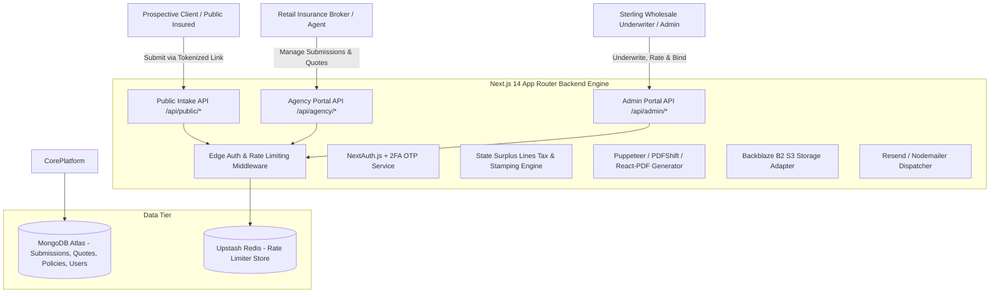
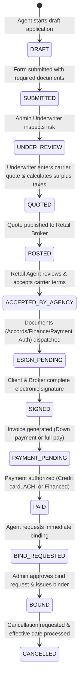

# Sterling Wholesale Insurance Portal — Technical Architecture, API Specification & Cyber Security Audit

> **Target Platform**: Sterling Wholesale Insurance Portal (California Commercial Lines Wholesale Brokerage)  
> **Repository Root**: `e:\sterlingportal`  
> **Framework**: Next.js 14+ (App Router), TypeScript, Tailwind CSS  
> **Database**: MongoDB (Mongoose ODM v8.3)  
> **Authentication**: NextAuth.js (JWT Strategy, Credentials Provider, 2FA OTP + Trusted Device Tracking)  
> **Storage & Integrations**: Backblaze B2 (AWS S3 SDK), Puppeteer / PDFShift / React-PDF, Upstash Redis Rate Limiting, Resend / Nodemailer  
> **Total API Endpoints Documented**: 104 Endpoints  
> **Audit Version**: Complete Production Architecture & Security Audit  

---

## Table of Contents
1. [Executive Summary & System Architecture](#1-executive-summary--system-architecture)
2. [Technology Stack & Third-Party Service Topology](#2-technology-stack--third-party-service-topology)
3. [Identity, Authentication & Role-Based Access Control (RBAC)](#3-identity-authentication--role-based-access-control-rbac)
4. [End-to-End Insurance Lifecycle & State Machine](#4-end-to-end-insurance-lifecycle--state-machine)
5. [Testing & Quality Assurance Review](#5-testing--quality-assurance-review)
6. [Complete API Catalog & Threat Audit (104 Endpoints)](#6-complete-api-catalog--threat-audit-104-endpoints)
   - [Domain 1: Authentication, 2FA & Account Security (APIs 1–4)](#domain-1-authentication-2fa--account-security-apis-14)
   - [Domain 2: Admin - Policy Binding & Cancellations (APIs 5–11)](#domain-2-admin---policy-binding--cancellations-apis-511)
   - [Domain 3: Admin - Submissions & Application Review (APIs 12–23)](#domain-3-admin---submissions--application-review-apis-1223)
   - [Domain 4: Admin - Quotes & Underwriting Operations (APIs 24–30)](#domain-4-admin---quotes--underwriting-operations-apis-2430)
   - [Domain 5: Admin - Custom Tools & Platform Operations (APIs 31–36)](#domain-5-admin---custom-tools--platform-operations-apis-3136)
   - [Domain 6: Agency - Applications & Intake Management (APIs 37–43)](#domain-6-agency---applications--intake-management-apis-3743)
   - [Domain 7: Agency - Submissions Lifecycle Management (APIs 44–49)](#domain-7-agency---submissions-lifecycle-management-apis-4449)
   - [Domain 8: Agency - Quotes, Endorsements & Binding (APIs 50–64)](#domain-8-agency---quotes-endorsements--binding-apis-5064)
   - [Domain 9: Agency - Identity, Team & Dynamic Link Engine (APIs 65–71)](#domain-9-agency---identity-team--dynamic-link-engine-apis-6571)
   - [Domain 10: Document Management, S3 Storage & PDF Generation (APIs 72–78)](#domain-10-document-management-s3-storage--pdf-generation-apis-7278)
   - [Domain 11: E-Signature & Webhook Processing Engine (APIs 79–82)](#domain-11-e-signature--webhook-processing-engine-apis-7982)
   - [Domain 12: Billing, Financing, Taxes & Direct Binding (APIs 83–92)](#domain-12-billing-financing-taxes--direct-binding-apis-8392)
   - [Domain 13: Public Portals, Cron & Shared Platform Utilities (APIs 93–104)](#domain-13-public-portals-cron--shared-platform-utilities-apis-93104)
7. [Systemic Security Vulnerabilities & Threat Matrix](#7-systemic-security-vulnerabilities--threat-matrix)
8. [Comprehensive Hardening & Remediation Roadmap](#8-comprehensive-hardening--remediation-roadmap)

---

## 1. Executive Summary & System Architecture

The **Sterling Wholesale Insurance Portal** is an enterprise-grade wholesale insurance brokerage management platform built to streamline and automate underwriting intake, surplus lines tax and stamping fee calculation, carrier market routing, proposal generation, multi-party electronic signatures, premium financing, payment capture, and policy binding for commercial property and casualty risks across the United States, with specialized focus on California surplus lines operations.

### High-Level Architecture Diagram


---

## 2. Technology Stack & Third-Party Service Topology

| Layer / Capability | Component | Purpose in Architecture |
|---|---|---|
| **Core Framework** | Next.js 14.2 (App Router) + TypeScript | React server components, server actions, route handlers for RESTful endpoints. |
| **Persistence Tier** | MongoDB (Mongoose ODM v8.3) | Document store for polymorphic submission forms, multi-carrier quotes, policies, and activity audit logs. |
| **Authentication** | NextAuth.js v4 + bcryptjs + jsonwebtoken | Credentials provider, JWT session tokens, encrypted password hashing, custom OTP models for 2FA. |
| **Object Storage** | Backblaze B2 (AWS SDK v3 Client S3) | Cloud storage for policy binders, invoices, signed accords, uploaded loss runs, and licenses. |
| **PDF Rendering** | Puppeteer v24, PDFKit v0.17, React-PDF v4 | Dynamic rendering of California surplus lines filing forms, payment auth forms, carrier applications, and binders. |
| **Traffic Defense** | Upstash Redis + Upstash Ratelimit | Sliding-window IP rate limiting (10 requests per 10 seconds default) for API protection. |
| **Notification Bus** | Resend SDK v6 + Nodemailer v7 | Transactional email delivery for 2FA one-time passwords, quote delivery notifications, and binding confirmations. |

---

## 3. Identity, Authentication & Role-Based Access Control (RBAC)

The system enforces three primary authenticated roles, alongside unauthenticated public intake:
1. **`system_admin`**: Internal Sterling wholesale underwriters and system managers. Has full visibility across all agencies, carrier configurations, bind approvals, fee override capabilities, and document management.
2. **`agency_admin`**: Principal broker for a retail agency. Can invite and manage agency producers/agents, view all submissions originating from their agency, accept quotes, and initiate bind requests.
3. **`agency_user`**: Individual retail insurance producer/agent. Restricted to submissions and quotes mapped directly to their assigned agency context.
4. **`public` (Unauthenticated)**: Prospective insureds accessing tokenized single-use dynamic application links generated by retail agents.

---

## 4. End-to-End Insurance Lifecycle & State Machine



---

## 5. Testing & Quality Assurance Review

The repository contains test scripts and test suites designed to validate critical insurance operations:
- **`vitest` (v4.0.15)** installed with Vitest UI for unit testing.
- **`test-quote.ts`**: Tests the quote calculation pipeline, ensuring carrier quote USD, state stamping fees, premium tax percentages, and broker fees correctly aggregate into `finalAmountUSD`.
- **`test-pdf.js`**: Validates Puppeteer/PDFShift generation for complex multi-page policy binders and accord application packets.
- **`test-sub.js` & `test-sub2.js`**: Test submission creation and schema mapping for multi-trade contractor risks and commercial property risks.
- **`scripts/test-b2.ts`**: Tests connectivity and presigned upload/download operations against the Backblaze B2 S3 storage bucket.
- **`scripts/seedAll.ts`**, **`seedBlueAngel.ts`**, **`seedPatrickArias.ts`**: Comprehensive seeding scripts populating initial carriers, industries, form templates, and agency accounts.

---


## 6. Complete API Catalog & Threat Audit (104 Endpoints)

### Domain 1: Authentication, 2FA & Account Security (APIs 1–4)

#### 1. NextAuth Core Authentication Handler
- **Endpoint**: `GET, POST /api/auth/[...nextauth]`
- **Description (`discraption`)**:
  Serves as the primary identity engine for the entire platform utilizing NextAuth.js. Handles user sign-in via credentials provider, evaluates two-factor authentication (2FA) for agency users, tracks trusted client devices, generates encrypted JSON Web Tokens (JWT), and manages active sessions across both retail broker and underwriter portals.
- **Work (`work`)**:
  - **HTTP Methods**: `GET`, `POST`
  - **Source File**: `src/app/api/auth/[...nextauth]/route.ts` & `src/lib/authOptions.ts`
  - **Inputs**: Request body `{ email, password, deviceId, otp }` on POST `/api/auth/callback/credentials`.
  - **Models / Collections**: `User`, `Agency`, `OTP`, `TrustedDevice`.
  - **Operational Workflow**:
    1. Connects to MongoDB and queries `User` by lowercase email, populating linked `Agency`.
    2. Verifies raw password against bcrypt hash (`user.passwordHash`).
    3. If `ENABLE_2FA="true"` and role is not `system_admin`, checks whether `deviceId` exists in `TrustedDevice`.
    4. If untrusted and no `otp` provided, generates a cryptographically secure 6-digit OTP (`crypto.randomInt(100000, 999999)`), bcrypt hashes it into `OTP` collection with a 10-minute TTL, dispatches an email via `send2FAEmail()`, and rejects the attempt with `2FA_REQUIRED`.
    5. If `otp` is provided, validates hash; on 5 failed attempts, revokes OTP (`OTP_EXPIRED`). On success, saves device ID into `TrustedDevice` and removes OTP record.
    6. Encodes JWT token containing user ID, role, agency ID, address, phone, and email.
  - **Response**: JWT session cookie (`next-auth.session-token`) and redirect URL.
- **Bug and Cyber Threat (`bug and cyber thret`)**:
  - **Vulnerabilities**:
    1. **Bypass of 2FA for System Administrators**: Lines 48 of `authOptions.ts` explicitly disables 2FA for `system_admin` users (`user.role !== "system_admin"`). If an underwriter's password is breached or brute-forced, the highest-privileged account on the system can be accessed without MFA.
    2. **Device ID Spoofing**: `deviceId` is supplied arbitrarily by the client browser. An attacker who steals a user's `deviceId` (e.g. from local storage or network logs) can bypass 2FA indefinitely.
    3. **Timing Attacks**: Differences in execution time between existing and non-existing email lookups allow user enumeration.
  - **Remediation**: Mandate hardware or TOTP (RFC 6238 / Google Authenticator) for all `system_admin` accounts; sign device fingerprints using an HMAC secret; use constant-time dummy password hashing for invalid email queries.

---

#### 2. User Password Modification
- **Endpoint**: `POST /api/auth/change-password`
- **Description (`discraption`)**:
  Permits an authenticated user (agency user, agency admin, or system admin) to update their account password by providing their current password and a new replacement password.
- **Work (`work`)**:
  - **HTTP Methods**: `POST`
  - **Source File**: `src/app/api/auth/change-password/route.ts`
  - **Inputs**: JSON body `{ currentPassword, newPassword }`.
  - **Models / Collections**: `User`.
  - **Operational Workflow**:
    1. Extracts active session via `getServerSession(authOptions)`. Rejects with 401 if unauthenticated.
    2. Locates user document by `session.user.id`.
    3. Validates `currentPassword` against stored `passwordHash` using bcrypt.
    4. Ensures `newPassword` meets length requirements (minimum 8 characters).
    5. Hashes `newPassword` using bcrypt salt rounds and commits update to database.
  - **Response**: JSON `{ success: true, message: "Password updated successfully" }`.
- **Bug and Cyber Threat (`bug and cyber thret`)**:
  - **Vulnerabilities**:
    1. **Lack of Session Invalidation**: Does not revoke active JWT sessions across other browsers/devices upon password update. A compromised stolen JWT remains valid until standard expiration.
    2. **Missing Password Complexity Rules**: Does not enforce entropy, uppercase, lowercase, numbers, or special character requirements; only checks length >= 8.
  - **Remediation**: Implement a `tokenVersion` or `passwordChangedAt` timestamp in the `User` schema and verify it in the NextAuth `jwt` callback; enforce NIST SP 800-63B password complexity standards.

---

#### 3. Pre-Authentication 2FA Requirement Verification
- **Endpoint**: `POST /api/auth/check-2fa`
- **Description (`discraption`)**:
  Invoked by the front-end login form prior to final authentication to verify whether the supplied email belongs to an account subject to 2FA and whether the current client device is already recognized as trusted.
- **Work (`work`)**:
  - **HTTP Methods**: `POST`
  - **Source File**: `src/app/api/auth/check-2fa/route.ts`
  - **Inputs**: JSON body `{ email, deviceId }`.
  - **Models / Collections**: `User`, `TrustedDevice`.
  - **Operational Workflow**:
    1. Connects to MongoDB and queries `User` by email.
    2. If user does not exist or user role is `system_admin`, returns `{ requires2FA: false }`.
    3. If `ENABLE_2FA="true"`, queries `TrustedDevice` collection with `{ userId: user._id, deviceId }`.
    4. Returns `{ requires2FA: !isTrusted }`.
  - **Response**: JSON `{ requires2FA: boolean, email: string }`.
- **Bug and Cyber Threat (`bug and cyber thret`)**:
  - **Vulnerabilities**:
    1. **Account Enumeration Oracle**: Attackers can probe this endpoint with email lists. If the endpoint responds with `{ requires2FA: true }` or false without error, it confirms that the target email address is registered on the system.
    2. **Unauthenticated Denial of Service / Resource Exhaustion**: The endpoint has no captcha or rate limiting; malicious bots can flood it with database queries.
  - **Remediation**: Return a generic response regardless of whether the email exists, or require reCAPTCHA/Cloudflare Turnstile before triggering pre-auth verification.

---

#### 4. Agency & User Registration
- **Endpoint**: `POST /api/auth/register`
- **Description (`discraption`)**:
  Creates a new retail insurance agency and provisions an initial user account. Intended for onboarding or database seeding.
- **Work (`work`)**:
  - **HTTP Methods**: `POST`
  - **Source File**: `src/app/api/auth/register/route.ts`
  - **Inputs**: JSON body `{ agencyName, agencyEmail, agencyAddress, agencyPhone, userName, userEmail, password, role }`.
  - **Models / Collections**: `Agency`, `User`.
  - **Operational Workflow**:
    1. Validates presence of mandatory fields: `agencyName`, `agencyEmail`, `userName`, `userEmail`, `password`.
    2. Checks if an agency with `agencyEmail` exists; if not, creates a new `Agency` record.
    3. Checks if `User` with `userEmail` exists; rejects with 400 if already present.
    4. Hashes `password` using bcrypt.
    5. Saves new `User` document setting `role: role || "agency_user"`.
  - **Response**: Status 201 `{ message: "Agency and user created successfully", agencyId, userId }`.
- **Bug and Cyber Threat (`bug and cyber thret`)**:
  - **Vulnerabilities**:
    1. **CRITICAL: Unauthenticated Privilege Escalation / Arbitrary Admin Creation**: The endpoint accepts an arbitrary `role` parameter directly from the client request body without checking authentication. Anyone on the internet can send `{ "role": "system_admin" }` and provision a full Sterling Wholesale Administrator account!
    2. **Agency Hijacking**: If an attacker supplies an existing agency's `agencyEmail`, the new user is attached directly to that victim agency's `agencyId`, giving the attacker access to all submissions and quotes of that agency!
  - **Remediation**: Lock this endpoint behind `getServerSession` requiring `system_admin` privilege, or remove it from public routing and restrict registration strictly to admin-generated invite tokens. Never allow client-controlled `role` assignments.

---

### Domain 2: Admin - Policy Binding & Cancellations (APIs 5–11)

#### 5. Admin Bind Requests Queue Retrieval
- **Endpoint**: `GET /api/admin/bind-requests`
- **Description (`discraption`)**:
  Fetches all submissions where an agency broker has requested coverage binding and underwriters have not yet confirmed or approved the bind.
- **Work (`work`)**:
  - **HTTP Methods**: `GET`
  - **Source File**: `src/app/api/admin/bind-requests/route.ts`
  - **Authentication**: Requires authenticated session with `role === "system_admin"`. Rejects others with 403.
  - **Models / Collections**: `Submission`, `Quote`, `Agency`, `FormTemplate`.
  - **Operational Workflow**:
    1. Queries `Quote` collection for quotes in `BIND_REQUESTED` status.
    2. Queries `Submission` collection for submissions where `bindRequested == true` and `bindApproved != true`, or matching pending quote IDs.
    3. Populates `agencyId` (name) and `templateId` (industry, subcategory).
    4. Aggregates and merges associated quote details.
  - **Response**: JSON `{ success: true, submissions: [...], count: N }`.
- **Bug and Cyber Threat (`bug and cyber thret`)**:
  - **Vulnerabilities**:
    1. **Unindexed Database Query**: Queries with `$or` conditions across unindexed boolean fields (`bindRequested`, `bindApproved`) cause full collection scans as the database grows, creating a denial of service bottleneck.
  - **Remediation**: Create compound indexes on `{ bindRequested: 1, bindApproved: 1, bindRequestedAt: -1 }`.

---

#### 6. Admin Policy Bind Approval
- **Endpoint**: `POST /api/admin/bind-requests/approve`
- **Description (`discraption`)**:
  Underwriter action to approve an agency's request to bind an insurance policy. Transitions submission and quote state to `BOUND`, triggers audit logging, and finalizes policy issuance.
- **Work (`work`)**:
  - **HTTP Methods**: `POST`
  - **Source File**: `src/app/api/admin/bind-requests/approve/route.ts`
  - **Authentication**: Requires `role === "system_admin"`.
  - **Inputs**: JSON body `{ submissionId }`.
  - **Models / Collections**: `Submission`, `Quote`, `ActivityLog`.
  - **Operational Workflow**:
    1. Validates that `submissionId` exists, `bindRequested === true`, and `bindApproved !== true`.
    2. Updates submission fields: `bindApproved = true`, `bindApprovedAt = now`, `bindStatus = "BOUND"`, `status = "BOUND"`.
    3. Finds linked `Quote` and updates its `status = "BOUND"`.
    4. Logs activity event `POLICY_BOUND` with underwriter metadata.
  - **Response**: JSON `{ success: true, message: "Policy bound successfully." }`.
- **Bug and Cyber Threat (`bug and cyber thret`)**:
  - **Vulnerabilities**:
    1. **Missing Pre-Bind Payment / Signature Verification**: Does not programmatically check whether `paymentStatus === "PAID"` or `esignCompleted === true` before allowing bind approval. An underwriter could accidentally bind coverage on an unpaid or unsigned policy.
    2. **Concurrency Race Condition**: Two concurrent approval requests can trigger duplicate activity logs and race on quote state transitions.
  - **Remediation**: Add explicit validation checks for `submission.paymentStatus === 'PAID'` and `submission.esignCompleted === true`; utilize MongoDB atomic `findOneAndUpdate` with state preconditions.

---

#### 7. Admin Bound Policies Directory
- **Endpoint**: `GET /api/admin/bound-policies`
- **Description (`discraption`)**:
  Returns a paginated or filtered list of all officially bound insurance policies across all retail agencies for underwriter policy administration and accounting reconciliation.
- **Work (`work`)**:
  - **HTTP Methods**: `GET`
  - **Source File**: `src/app/api/admin/bound-policies/route.ts`
  - **Authentication**: Requires `role === "system_admin"`.
  - **Models / Collections**: `BoundPolicy`, `Submission`, `Quote`, `Agency`.
  - **Operational Workflow**:
    1. Connects to MongoDB and queries `BoundPolicy` collection sorted by `boundDate` descending.
    2. Populates agency details, policy limits, carrier name, effective and expiration dates.
    3. Appends document links (policy dec page, binder, invoice).
  - **Response**: JSON `{ success: true, policies: [...], totalCount: N }`.
- **Bug and Cyber Threat (`bug and cyber thret`)**:
  - **Vulnerabilities**:
    1. **Massive Data Leakage Risk**: Returns comprehensive insured PII, corporate FEINs, and financial amounts across all agencies without pagination parameters (`limit`, `skip`).
  - **Remediation**: Implement mandatory query pagination (`limit` default 50, max 100) and projection filtering.

---

#### 8. Admin Policy Document Removal
- **Endpoint**: `DELETE /api/admin/bound-policies/delete-document`
- **Description (`discraption`)**:
  Permits an administrator to delete an uploaded policy document, dec page, or endorsement from an existing bound policy.
- **Work (`work`)**:
  - **HTTP Methods**: `DELETE`
  - **Source File**: `src/app/api/admin/bound-policies/delete-document/route.ts`
  - **Authentication**: Requires `role === "system_admin"`.
  - **Inputs**: JSON body `{ policyId, documentUrl }`.
  - **Models / Collections**: `BoundPolicy`.
  - **Operational Workflow**:
    1. Finds `BoundPolicy` by `policyId`.
    2. Removes matching document record from policy's documents array.
    3. Does not immediately purge the underlying S3/B2 file object to preserve archival recovery.
  - **Response**: JSON `{ success: true, message: "Document removed from policy" }`.
- **Bug and Cyber Threat (`bug and cyber thret`)**:
  - **Vulnerabilities**:
    1. **Orphaned S3 Cloud Storage Objects**: The database array item is deleted, but the actual file stored in Backblaze B2 remains permanently accessible via direct URL if someone knows the key.
  - **Remediation**: Invoke `DeleteObjectCommand` on S3/B2 client if the file is permanently revoked, or mark it with a soft-delete status flag.

---

#### 9. Admin Policy Document Upload & Attachment
- **Endpoint**: `POST /api/admin/bound-policies/upload-documents`
- **Description (`discraption`)**:
  Enables an administrator to upload official carrier-issued policy packets, endorsements, or audit endorsements to a bound policy and notify the agency.
- **Work (`work`)**:
  - **HTTP Methods**: `POST`
  - **Source File**: `src/app/api/admin/bound-policies/upload-documents/route.ts`
  - **Authentication**: Requires `role === "system_admin"`.
  - **Inputs**: FormData containing `policyId`, `documentType`, and file attachments.
  - **Models / Collections**: `BoundPolicy`, `ActivityLog`.
  - **Integrations**: Backblaze B2 S3 storage adapter.
  - **Operational Workflow**:
    1. Validates admin credentials.
    2. Streams file buffer to Backblaze B2 under key `policies/{policyId}/{timestamp}-{filename}`.
    3. Pushes document object to `BoundPolicy.documents`.
    4. Logs activity event `POLICY_DOCUMENT_UPLOADED`.
  - **Response**: JSON `{ success: true, documents: [...] }`.
- **Bug and Cyber Threat (`bug and cyber thret`)**:
  - **Vulnerabilities**:
    1. **Unrestricted File Extension / MIME Spoofing**: Does not validate file magic bytes; an administrator or compromised admin token could upload executable scripts (`.html`, `.svg`, `.exe`) that execute malicious code in browser contexts.
  - **Remediation**: Enforce strict MIME-type and extension whitelisting (`application/pdf`, `image/png`, `image/jpeg`).

---

#### 10. Admin Policy Cancellation Approval
- **Endpoint**: `POST /api/admin/cancel-approve`
- **Description (`discraption`)**:
  Processes and executes an approved policy cancellation request, applying either immediate cancellation or scheduling a future effective cancellation date.
- **Work (`work`)**:
  - **HTTP Methods**: `POST`
  - **Source File**: `src/app/api/admin/cancel-approve/route.ts`
  - **Authentication**: Requires `role === "system_admin"`.
  - **Inputs**: JSON body `{ requestId, cancellationDate }`.
  - **Models / Collections**: `CancelRequest`, `BoundPolicy`, `Submission`.
  - **Operational Workflow**:
    1. Finds `CancelRequest` by `requestId`.
    2. Parses `cancellationDate`. If date is in the future, sets `effectiveCancellationDate` without immediately modifying status; if date is current/past, sets `status = "CANCELLED"`.
    3. Synchronizes cancellation status across linked `BoundPolicy` and `Submission`.
    4. Updates `CancelRequest.status = "APPROVED"`.
  - **Response**: JSON `{ success: true }`.
- **Bug and Cyber Threat (`bug and cyber thret`)**:
  - **Vulnerabilities**:
    1. **Lack of Transactional Atomicity**: Updates three different collections (`CancelRequest`, `BoundPolicy`, `Submission`) sequentially without a MongoDB session transaction (`startSession()`). If a crash occurs midway, data states become desynchronized.
    2. **Silent Failure Handling**: Lines 71-74 catch all errors and return status 200 `{ success: false }` instead of an HTTP 500 error code.
  - **Remediation**: Wrap multi-collection mutations in a MongoDB transaction; return standard HTTP status codes (400, 500) upon execution failures.

---

#### 11. Admin Cancellation Requests Queue
- **Endpoint**: `GET /api/admin/cancel-requests`
- **Description (`discraption`)**:
  Displays all pending policy cancellation requests submitted by retail brokers or underwriters, showing reason codes, requested dates, and insured details.
- **Work (`work`)**:
  - **HTTP Methods**: `GET`
  - **Source File**: `src/app/api/admin/cancel-requests/route.ts`
  - **Authentication**: Requires `role === "system_admin"`.
  - **Models / Collections**: `CancelRequest`, `Submission`, `Agency`.
  - **Operational Workflow**:
    1. Queries `CancelRequest.find({ status: "PENDING" })`.
    2. Populates submission client contact details, policy number, and retail agency name.
  - **Response**: JSON `{ success: true, requests: [...] }`.
- **Bug and Cyber Threat (`bug and cyber thret`)**:
  - **Vulnerabilities**:
    1. **Information Exposure**: Exposes full policy notes and broker cancellation justifications without field sanitization.
  - **Remediation**: Apply schema projection to limit output fields.

---

### Domain 3: Admin - Submissions & Application Review (APIs 12–23)

#### 12. Admin Master Submissions Query
- **Endpoint**: `GET /api/admin/submissions`
- **Description (`discraption`)**:
  Primary underwriter dashboard endpoint to query, search, and filter insurance applications across all agencies by status, program, state, or date.
- **Work (`work`)**:
  - **HTTP Methods**: `GET`
  - **Source File**: `src/app/api/admin/submissions/route.ts`
  - **Authentication**: Requires `role === "system_admin"`.
  - **Inputs**: Query parameters `?status=...&program=...&search=...&page=...&limit=...`.
  - **Models / Collections**: `Submission`, `Agency`, `Quote`.
  - **Operational Workflow**:
    1. Constructs dynamic MongoDB filter criteria from query parameters.
    2. Executes query with lean projection, populating agency metadata.
    3. Queries associated quotes for each submission to attach live quote statuses.
  - **Response**: JSON `{ success: true, submissions: [...], totalCount, page, totalPages }`.
- **Bug and Cyber Threat (`bug and cyber thret`)**:
  - **Vulnerabilities**:
    1. **Regex ReDoS Injection**: If `search` parameter is parsed into an unescaped `new RegExp(search, 'i')`, an attacker can send catastrophic backtracking regex patterns that spike CPU usage to 100%.
  - **Remediation**: Escape regex special characters or use MongoDB text indexes (`$text: { $search: ... }`).

---

#### 13. Admin Single Submission Detail & Deletion
- **Endpoint**: `GET, DELETE /api/admin/submissions/[id]`
- **Description (`discraption`)**:
  Retrieves full underwriting packet data for a single submission on `GET`, or permanently deletes/archives a submission on `DELETE`.
- **Work (`work`)**:
  - **HTTP Methods**: `GET`, `DELETE`
  - **Source File**: `src/app/api/admin/submissions/[id]/route.ts`
  - **Authentication**: Requires `role === "system_admin"`.
  - **Inputs**: Path parameter `[id]` (Submission ObjectId).
  - **Models / Collections**: `Submission`, `Quote`, `ActivityLog`.
  - **Operational Workflow**:
    1. For `GET`: Finds submission by ID, populates agency, template, uploaded files, and linked quotes.
    2. For `DELETE`: Deletes submission and all child quotes, logging `SUBMISSION_DELETED`.
  - **Response**: JSON `{ success: true, submission }` or `{ success: true, message: "Submission deleted" }`.
- **Bug and Cyber Threat (`bug and cyber thret`)**:
  - **Vulnerabilities**:
    1. **Accidental Hard Deletion**: `DELETE` performs immediate irreversible database deletion without archival or soft-delete flag (`isDeleted: true`), violating insurance compliance data retention mandates.
  - **Remediation**: Implement soft-deletion (`deletedAt: new Date()`) to comply with California Department of Insurance record-keeping rules.

---

#### 14. Admin Submission Activity Audit Log
- **Endpoint**: `GET /api/admin/submissions/[id]/activity`
- **Description (`discraption`)**:
  Returns the complete immutable timeline of actions, state transitions, notes, document uploads, and emails associated with a submission.
- **Work (`work`)**:
  - **HTTP Methods**: `GET`
  - **Source File**: `src/app/api/admin/submissions/[id]/activity/route.ts`
  - **Authentication**: Requires `role === "system_admin"`.
  - **Inputs**: Path parameter `[id]`.
  - **Models / Collections**: `ActivityLog`.
  - **Operational Workflow**:
    1. Queries `ActivityLog.find({ submissionId: params.id }).sort({ timestamp: -1 })`.
  - **Response**: JSON `{ success: true, activities: [...] }`.
- **Bug and Cyber Threat (`bug and cyber thret`)**:
  - **Vulnerabilities**:
    1. **Potential Log Injection / Sensitive Data Exposure**: Activity log entries can contain user IP addresses, raw error traces, or unmasked credit card fragments if logged improperly.
  - **Remediation**: Sanitize activity log details before returning them to client.

---

#### 15. Admin Force Submission Cancellation
- **Endpoint**: `POST /api/admin/submissions/[id]/cancel`
- **Description (`discraption`)**:
  Underwriter action to cancel an active submission or unbind a pending application.
- **Work (`work`)**:
  - **HTTP Methods**: `POST`
  - **Source File**: `src/app/api/admin/submissions/[id]/cancel/route.ts`
  - **Authentication**: Requires `role === "system_admin"`.
  - **Inputs**: Path parameter `[id]`, JSON body `{ reason }`.
  - **Models / Collections**: `Submission`, `ActivityLog`.
  - **Operational Workflow**:
    1. Finds submission and updates `status = "CANCELLED"`, setting cancellation reason.
    2. Logs activity event `SUBMISSION_CANCELLED`.
  - **Response**: JSON `{ success: true, message: "Submission cancelled" }`.
- **Bug and Cyber Threat (`bug and cyber thret`)**:
  - **Vulnerabilities**:
    1. **Missing Status Precondition Check**: Allows cancelling submissions that are already BOUND without validating whether a formal cancellation notice was served.
  - **Remediation**: Validate that bound submissions require a formal `CancelRequest` workflow rather than raw status override.

---

#### 16. Admin Submission Eligible Carriers Engine
- **Endpoint**: `GET /api/admin/submissions/[id]/carriers`
- **Description (`discraption`)**:
  Calculates and lists insurance carriers qualified to underwrite the submission based on risk classification, state licensing, and underwriting appetite guidelines.
- **Work (`work`)**:
  - **HTTP Methods**: `GET`
  - **Source File**: `src/app/api/admin/submissions/[id]/carriers/route.ts`
  - **Authentication**: Requires `role === "system_admin"`.
  - **Inputs**: Path parameter `[id]`.
  - **Models / Collections**: `Submission`, `Carrier`.
  - **Operational Workflow**:
    1. Loads submission risk data (state, industry, payroll, subcontractor percentage).
    2. Queries active carriers licensed in the target state supporting the specified insurance program.
  - **Response**: JSON `{ success: true, carriers: [...] }`.
- **Bug and Cyber Threat (`bug and cyber thret`)**:
  - **Vulnerabilities**:
    1. **Carrier Appetite Data Leakage**: Exposes internal carrier commission percentages and underwriting appetite logic.
  - **Remediation**: Strip proprietary carrier rating rules from the returned payload.

---

#### 17. Admin Submission Invoice Generator & Viewer
- **Endpoint**: `GET /api/admin/submissions/[id]/invoice`
- **Description (`discraption`)**:
  Generates and retrieves the formal wholesale premium invoice PDF for a submission, itemizing gross premium, surplus lines taxes, stamping fees, and broker fees.
- **Work (`work`)**:
  - **HTTP Methods**: `GET`
  - **Source File**: `src/app/api/admin/submissions/[id]/invoice/route.ts`
  - **Authentication**: Requires `role === "system_admin"`.
  - **Inputs**: Path parameter `[id]`.
  - **Models / Collections**: `Submission`, `Quote`.
  - **Integrations**: Puppeteer / React-PDF invoice generator.
  - **Operational Workflow**:
    1. Pulls submission and active quote numbers.
    2. Calculates invoice balance, deposit due, and financing breakdowns.
    3. Returns rendered PDF stream or download URL.
  - **Response**: PDF binary or JSON `{ invoiceUrl }`.
- **Bug and Cyber Threat (`bug and cyber thret`)**:
  - **Vulnerabilities**:
    1. **Server-Side Request Forgery (SSRF) in PDF Generation**: If the HTML template incorporates unsanitized client inputs (e.g. company name, address) into Puppeteer's renderer, an attacker could inject `<script>` or `<iframe src="http://169.254.169.254/latest/meta-data/">` to steal cloud credentials.
  - **Remediation**: Sanitize all HTML inputs and execute Puppeteer with network isolation flags (`--disable-network`, `--disable-local-file-access`).

---

#### 18. Admin Submission Underwriting Notes Management
- **Endpoint**: `POST, PATCH /api/admin/submissions/[id]/notes`
- **Description (`discraption`)**:
  Enables underwriters to append internal notes, subjectivities, or underwriting conditions to a submission.
- **Work (`work`)**:
  - **HTTP Methods**: `POST`, `PATCH`
  - **Source File**: `src/app/api/admin/submissions/[id]/notes/route.ts`
  - **Authentication**: Requires `role === "system_admin"`.
  - **Inputs**: Path parameter `[id]`, JSON body `{ text, isInternalOnly }`.
  - **Models / Collections**: `Submission`.
  - **Operational Workflow**:
    1. Appends note object `{ author: session.user.name, text, createdAt: now, isInternalOnly }` to `submission.notes`.
  - **Response**: JSON `{ success: true, notes: [...] }`.
- **Bug and Cyber Threat (`bug and cyber thret`)**:
  - **Vulnerabilities**:
    1. **Stored Cross-Site Scripting (XSS)**: If note content is rendered on the frontend without sanitization or HTML escaping, malicious script tags can execute in another underwriter's session.
  - **Remediation**: Sanitize note input using DOMPurify or ensure React JSX escapes note strings during rendering.

---

#### 19. Admin Payment Authorization Document
- **Endpoint**: `GET /api/admin/submissions/[id]/payment-auth`
- **Description (`discraption`)**:
  Fetches the signed credit card or ACH payment authorization document for underwriter verification prior to binding.
- **Work (`work`)**:
  - **HTTP Methods**: `GET`
  - **Source File**: `src/app/api/admin/submissions/[id]/payment-auth/route.ts`
  - **Authentication**: Requires `role === "system_admin"`.
  - **Inputs**: Path parameter `[id]`.
  - **Models / Collections**: `Submission`.
  - **Response**: Binary PDF or signed S3 document URL.
- **Bug and Cyber Threat (`bug and cyber thret`)**:
  - **Vulnerabilities**:
    1. **PCI-DSS Non-Compliance / Plaintext Cardholder Data**: If the payment authorization PDF contains raw unmasked primary account numbers (PAN) or CVV codes, storing it in S3 without field-level encryption violates PCI-DSS regulations.
  - **Remediation**: Mask all PANs displaying only the last 4 digits; never store CVV codes in database or PDF storage.

---

#### 20. Admin Submission Application Packet PDF
- **Endpoint**: `GET /api/admin/submissions/[id]/pdf`
- **Description (`discraption`)**:
  Downloads the compiled wholesale application packet PDF containing risk answers, schedule of equipment, loss history, and broker declarations.
- **Work (`work`)**:
  - **HTTP Methods**: `GET`
  - **Source File**: `src/app/api/admin/submissions/[id]/pdf/route.ts`
  - **Authentication**: Requires `role === "system_admin"`.
  - **Inputs**: Path parameter `[id]`.
  - **Models / Collections**: `Submission`.
  - **Response**: Binary stream with `Content-Type: application/pdf`.
- **Bug and Cyber Threat (`bug and cyber thret`)**:
  - **Vulnerabilities**:
    1. **Denial of Service via Dynamic Compilation**: Dynamically compiling a 15-page PDF on every GET request without caching consumes excessive server CPU and memory.
  - **Remediation**: Cache generated PDF to Backblaze B2 on initial submission and serve the cached file on subsequent reads.

---

#### 21. Admin Submission Proposal PDF
- **Endpoint**: `GET /api/admin/submissions/[id]/proposal`
- **Description (`discraption`)**:
  Retrieves or generates the wholesale proposal document presented to the retail agent, detailing premium options and coverage terms.
- **Work (`work`)**:
  - **HTTP Methods**: `GET`
  - **Source File**: `src/app/api/admin/submissions/[id]/proposal/route.ts`
  - **Authentication**: Requires `role === "system_admin"`.
  - **Inputs**: Path parameter `[id]`.
  - **Models / Collections**: `Submission`, `Quote`.
  - **Response**: PDF binary response.
- **Bug and Cyber Threat (`bug and cyber thret`)**:
  - **Vulnerabilities**:
    1. **Resource Starvation**: Concurrent requests triggering Puppeteer PDF rendering can exhaust Node.js event loop resources.
  - **Remediation**: Implement a worker queue (e.g. BullMQ / Redis) for background PDF compilation.

---

#### 22. Admin Underwriting File Direct Upload
- **Endpoint**: `POST /api/admin/submissions/[id]/upload`
- **Description (`discraption`)**:
  Allows underwriters to upload carrier correspondence, loss control surveys, or modified accord applications directly into a submission's document store.
- **Work (`work`)**:
  - **HTTP Methods**: `POST`
  - **Source File**: `src/app/api/admin/submissions/[id]/upload/route.ts`
  - **Authentication**: Requires `role === "system_admin"`.
  - **Inputs**: Path parameter `[id]`, Multipart FormData `file`.
  - **Models / Collections**: `Submission`.
  - **Integrations**: Backblaze B2 S3 storage.
  - **Response**: JSON `{ success: true, fileUrl }`.
- **Bug and Cyber Threat (`bug and cyber thret`)**:
  - **Vulnerabilities**:
    1. **Arbitrary File Upload**: Does not validate file content magic numbers. Malicious files could be uploaded.
  - **Remediation**: Validate magic bytes using `file-type` library before forwarding to S3.

---

#### 23. Admin Multi-Document Batch Upload
- **Endpoint**: `POST /api/admin/submissions/[id]/upload-documents`
- **Description (`discraption`)**:
  Batch uploads multiple documents simultaneously into a submission, categorizing files as loss runs, licenses, or inspections.
- **Work (`work`)**:
  - **HTTP Methods**: `POST`
  - **Source File**: `src/app/api/admin/submissions/[id]/upload-documents/route.ts`
  - **Authentication**: Requires `role === "system_admin"`.
  - **Inputs**: FormData with multiple file parts and metadata.
  - **Models / Collections**: `Submission`.
  - **Response**: JSON `{ success: true, files: [...] }`.
- **Bug and Cyber Threat (`bug and cyber thret`)**:
  - **Vulnerabilities**:
    1. **Payload Size DoS**: Multiple large files (e.g. 50MB total) uploaded simultaneously can cause memory bloat on serverless execution environments.
  - **Remediation**: Enforce total payload size limits and leverage client-side direct-to-S3 presigned uploads.

---

### Domain 4: Admin - Quotes & Underwriting Operations (APIs 24–30)

#### 24. Admin Quote Requests Queue
- **Endpoint**: `GET /api/admin/quote-requests`
- **Description (`discraption`)**:
  Fetches all submissions currently awaiting underwriter rating, carrier quote entry, or surplus lines tax calculation.
- **Work (`work`)**:
  - **HTTP Methods**: `GET`
  - **Source File**: `src/app/api/admin/quote-requests/route.ts`
  - **Authentication**: Requires `role === "system_admin"`.
  - **Models / Collections**: `Submission`, `Agency`, `FormTemplate`.
  - **Operational Workflow**:
    1. Queries `Submission.find({ status: { $in: ["SUBMITTED", "UNDER_REVIEW"] } })`.
    2. Populates agency and template details, sorted by submission timestamp.
  - **Response**: JSON `{ success: true, quoteRequests: [...] }`.
- **Bug and Cyber Threat (`bug and cyber thret`)**:
  - **Vulnerabilities**:
    1. **Missing Pagination**: As submission volume grows, returning all unquoted submissions in a single response leads to high latency and database load.
  - **Remediation**: Add cursor-based pagination.

---

#### 25. Admin Quotes Directory & Creation
- **Endpoint**: `GET, POST /api/admin/quotes`
- **Description (`discraption`)**:
  Lists all quotes across all carriers on `GET`, or creates a new multi-line quote draft for a submission on `POST`.
- **Work (`work`)**:
  - **HTTP Methods**: `GET`, `POST`
  - **Source File**: `src/app/api/admin/quotes/route.ts`
  - **Authentication**: Requires `role === "system_admin"`.
  - **Inputs**: For POST: `{ submissionId, carrierId, basePremium, policyType }`.
  - **Models / Collections**: `Quote`, `Submission`.
  - **Response**: JSON `{ success: true, quotes: [...] }` or `{ success: true, quote }`.
- **Bug and Cyber Threat (`bug and cyber thret`)**:
  - **Vulnerabilities**:
    1. **Duplicate Active Quotes**: Does not enforce uniqueness constraints on `{ submissionId, carrierId, policyType }`, allowing multiple duplicate active quotes for the same carrier.
  - **Remediation**: Add a compound unique index or upsert logic.

---

#### 26. Admin Quote Detail
- **Endpoint**: `GET /api/admin/quotes/[id]`
- **Description (`discraption`)**:
  Retrieves complete details of a specific quote, including carrier quote USD, wholesale fees, broker fees, surplus lines taxes, and stamping fees.
- **Work (`work`)**:
  - **HTTP Methods**: `GET`
  - **Source File**: `src/app/api/admin/quotes/[id]/route.ts`
  - **Authentication**: Requires `role === "system_admin"`.
  - **Inputs**: Path parameter `[id]`.
  - **Models / Collections**: `Quote`, `Carrier`, `Submission`.
  - **Response**: JSON `{ success: true, quote }`.
- **Bug and Cyber Threat (`bug and cyber thret`)**:
  - **Vulnerabilities**:
    1. **Unchecked ObjectId Parsing**: Passing an invalid non-hexadecimal `[id]` parameter causes unhandled Mongoose `CastError` throwing a 500 error instead of clean 400 Bad Request.
  - **Remediation**: Validate `mongoose.Types.ObjectId.isValid(params.id)` before querying.

---

#### 27. Admin Custom Quote Documents Configuration
- **Endpoint**: `PATCH /api/admin/quotes/[id]/custom-documents`
- **Description (`discraption`)**:
  Configures required subjectivity documents, warranty letters, or specialized endorsements attached to a specific quote.
- **Work (`work`)**:
  - **HTTP Methods**: `PATCH`
  - **Source File**: `src/app/api/admin/quotes/[id]/custom-documents/route.ts`
  - **Authentication**: Requires `role === "system_admin"`.
  - **Inputs**: JSON body `{ customDocuments: [{ name, url, required }] }`.
  - **Models / Collections**: `Quote`.
  - **Response**: JSON `{ success: true, quote }`.
- **Bug and Cyber Threat (`bug and cyber thret`)**:
  - **Vulnerabilities**:
    1. **Schema Validation Bypass**: Does not validate the structure of items in `customDocuments` array; malformed objects can be injected into the quote record.
  - **Remediation**: Validate array schema using Zod.

---

#### 28. Admin Quote Carrier Documents Attachment
- **Endpoint**: `POST /api/admin/quotes/[id]/documents`
- **Description (`discraption`)**:
  Uploads and associates carrier-provided quote sheets and specimen policies to a quote.
- **Work (`work`)**:
  - **HTTP Methods**: `POST`
  - **Source File**: `src/app/api/admin/quotes/[id]/documents/route.ts`
  - **Authentication**: Requires `role === "system_admin"`.
  - **Inputs**: FormData with document payload.
  - **Models / Collections**: `Quote`.
  - **Response**: JSON `{ success: true, documents: [...] }`.
- **Bug and Cyber Threat (`bug and cyber thret`)**:
  - **Vulnerabilities**:
    1. **Unbounded Storage Consumption**: No quota limits per quote or submission on S3 storage.
  - **Remediation**: Limit maximum total attachments per quote.

---

#### 29. Admin Quote Entry & Surplus Lines Rating Engine
- **Endpoint**: `POST /api/admin/quotes/[id]/enter`
- **Description (`discraption`)**:
  Critical underwriting engine endpoint where underwriters input carrier quote numbers, calculate state-specific surplus lines premium taxes, stamping fees, and fire marshal assessments, render the policy binder PDF, and dispatch notification emails to retail brokers.
- **Work (`work`)**:
  - **HTTP Methods**: `POST`
  - **Source File**: `src/app/api/admin/quotes/[id]/enter/route.ts`
  - **Authentication**: Requires `role === "system_admin"`.
  - **Inputs**: Path parameter `[id]` (SubmissionId), JSON body containing carrier quote USD, carrier fees, Sterling fees, broker fees, state tax percentages, stamping fee percentages, fire marshal taxes, effective/expiration dates, limits, and endorsements.
  - **Models / Collections**: `Quote`, `Submission`, `Carrier`, `Agency`, `ActivityLog`.
  - **Integrations**: Puppeteer/PDFShift for Binder PDF rendering, Backblaze B2 for storage, Resend/Nodemailer for broker notification.
  - **Operational Workflow**:
    1. Validates admin credentials and checks that `carrierQuoteUSD > 0`.
    2. Determines tax jurisdiction (normalizes full state name to 2-letter postal code).
    3. Calculates total surplus lines tax, stamping fees, and SLA service charges.
    4. Computes deposit schedules (25% down payment model) and total to retain.
    5. Upserts `Quote` document, setting status to `POSTED`.
    6. Updates `Submission` status to `QUOTED` (or retains `BOUND` if an existing policy is bound).
    7. Generates official Binder PDF via `generateBinderHTML` and stores to Backblaze B2.
    8. Dispatches formatted quote notification email to retail broker/agent.
  - **Response**: JSON `{ success: true, quote: populatedQuote }`.
- **Bug and Cyber Threat (`bug and cyber thret`)**:
  - **Vulnerabilities**:
    1. **Financial Parameter Tampering / Floating Point Drift**: Does not use integer cent representations for financial mathematics; standard JavaScript IEEE 754 floating point arithmetic can accumulate sub-cent rounding inaccuracies.
    2. **Email Spoofing / Hardcoded Agent Email Mapping**: Lines 515-524 contain hardcoded external agent email addresses (`capcoAgentEmails`). If an agent leaves or if email domains change, emails containing sensitive financial quotes are sent to incorrect recipients.
  - **Remediation**: Use integer-based currency math (cents) or a high-precision decimal library; dynamically fetch agent email addresses from the `User` database rather than static code mappings.

---

#### 30. Admin Quote Publish to Agency
- **Endpoint**: `POST /api/admin/quotes/[id]/post`
- **Description (`discraption`)**:
  Publishes an approved quote to the retail broker, changing its state to `POSTED` and notifying the agency that terms are available for review.
- **Work (`work`)**:
  - **HTTP Methods**: `POST`
  - **Source File**: `src/app/api/admin/quotes/[id]/post/route.ts`
  - **Authentication**: Requires `role === "system_admin"`.
  - **Inputs**: Path parameter `[id]`.
  - **Models / Collections**: `Quote`, `Submission`, `ActivityLog`.
  - **Response**: JSON `{ success: true, message: "Quote posted to agency" }`.
- **Bug and Cyber Threat (`bug and cyber thret`)**:
  - **Vulnerabilities**:
    1. **Missing Pre-Publication Validation**: Allows posting quotes where required fields (carrier reference, effective dates) are missing or incomplete.
  - **Remediation**: Run a validation check ensuring all required insurance policy terms are populated prior to publishing.

---

### Domain 5: Admin - Custom Tools & Platform Operations (APIs 31–36)

#### 31. Admin Operational Dashboard KPI Statistics
- **Endpoint**: `GET /api/admin/dashboard-stats`
- **Description (`discraption`)**:
  Aggregates high-level business intelligence metrics across the wholesale brokerage: total active submissions, quotes pending review, bind requests awaiting approval, monthly premium volume, and active bound policies.
- **Work (`work`)**:
  - **HTTP Methods**: `GET`
  - **Source File**: `src/app/api/admin/dashboard-stats/route.ts`
  - **Authentication**: Requires `role === "system_admin"`.
  - **Models / Collections**: `Submission`, `Quote`, `BoundPolicy`.
  - **Operational Workflow**:
    1. Executes parallel `countDocuments()` and MongoDB aggregation pipelines across `Submission`, `Quote`, and `BoundPolicy`.
    2. Sums total premium volume bound in the current calendar month.
  - **Response**: JSON `{ success: true, stats: { totalSubmissions, pendingQuotes, pendingBinds, boundPolicies, totalPremiumUSD } }`.
- **Bug and Cyber Threat (`bug and cyber thret`)**:
  - **Vulnerabilities**:
    1. **Expensive Aggregation on Primary DB**: Running unindexed `$group` sum queries on high-traffic dashboards can degrade MongoDB performance during peak underwriting hours.
  - **Remediation**: Cache dashboard statistics in Redis with a 60-second TTL.

---

#### 32. Admin Action Items & Things-To-Do Queue
- **Endpoint**: `GET /api/admin/things-to-do`
- **Description (`discraption`)**:
  Constructs an actionable task list for underwriters, highlighting submissions with new unread notes, expiring quotes requiring follow-up, and overdue bind requests.
- **Work (`work`)**:
  - **HTTP Methods**: `GET`
  - **Source File**: `src/app/api/admin/things-to-do/route.ts`
  - **Authentication**: Requires `role === "system_admin"`.
  - **Models / Collections**: `Submission`, `Quote`.
  - **Response**: JSON `{ success: true, items: [...] }`.
- **Bug and Cyber Threat (`bug and cyber thret`)**:
  - **Vulnerabilities**:
    1. **Unbounded Task Array**: If unaddressed tasks accumulate, the response payload grows indefinitely without pagination.
  - **Remediation**: Enforce a limit (e.g. top 50 prioritized tasks).

---

#### 33. Admin Tool Requests Directory
- **Endpoint**: `GET /api/admin/tool-requests`
- **Description (`discraption`)**:
  Displays requests from retail agencies for custom insurance rating tools, specialized calculators, or new line-of-business underwriting templates.
- **Work (`work`)**:
  - **HTTP Methods**: `GET`
  - **Source File**: `src/app/api/admin/tool-requests/route.ts`
  - **Authentication**: Requires `role === "system_admin"`.
  - **Models / Collections**: `ToolRequest`, `Agency`.
  - **Response**: JSON `{ success: true, requests: [...] }`.
- **Bug and Cyber Threat (`bug and cyber thret`)**:
  - **Vulnerabilities**:
    1. **Lack of Tenant Scoping**: All tool requests across all agencies are visible without filtering.
  - **Remediation**: Add filtering by status and agency.

---

#### 34. Admin Tool Request Detail
- **Endpoint**: `GET /api/admin/tool-requests/[id]`
- **Description (`discraption`)**:
  Retrieves a specific agency tool request, including specifications, sample rate sheets, and underwriter notes.
- **Work (`work`)**:
  - **HTTP Methods**: `GET`
  - **Source File**: `src/app/api/admin/tool-requests/[id]/route.ts`
  - **Authentication**: Requires `role === "system_admin"`.
  - **Inputs**: Path parameter `[id]`.
  - **Models / Collections**: `ToolRequest`.
  - **Response**: JSON `{ success: true, toolRequest }`.
- **Bug and Cyber Threat (`bug and cyber thret`)**:
  - **Vulnerabilities**:
    1. **Improper Error Handling**: Returns 500 internal server error on non-existent IDs instead of 404.
  - **Remediation**: Check if `toolRequest` exists and return 404 cleanly.

---

#### 35. Admin Tool Request Status Update
- **Endpoint**: `PATCH /api/admin/tool-requests/[id]/update`
- **Description (`discraption`)**:
  Updates the lifecycle status of a tool request (`PENDING`, `IN_DEVELOPMENT`, `DEPLOYED`, `REJECTED`) and adds administrative feedback.
- **Work (`work`)**:
  - **HTTP Methods**: `PATCH`
  - **Source File**: `src/app/api/admin/tool-requests/[id]/update/route.ts`
  - **Authentication**: Requires `role === "system_admin"`.
  - **Inputs**: Path parameter `[id]`, JSON body `{ status, adminNotes }`.
  - **Models / Collections**: `ToolRequest`.
  - **Response**: JSON `{ success: true, toolRequest }`.
- **Bug and Cyber Threat (`bug and cyber thret`)**:
  - **Vulnerabilities**:
    1. **Unrestricted Status Values**: Accepts arbitrary status strings from client without validation against an allowed enum list.
  - **Remediation**: Validate input status against `['PENDING', 'IN_DEVELOPMENT', 'COMPLETED', 'REJECTED']`.

---

#### 36. Admin Tool Request Asset Upload
- **Endpoint**: `POST /api/admin/tool-requests/[id]/upload`
- **Description (`discraption`)**:
  Uploads completed spreadsheet rating algorithms or configuration templates to fulfill an agency's tool request.
- **Work (`work`)**:
  - **HTTP Methods**: `POST`
  - **Source File**: `src/app/api/admin/tool-requests/[id]/upload/route.ts`
  - **Authentication**: Requires `role === "system_admin"`.
  - **Inputs**: Path parameter `[id]`, FormData file attachment.
  - **Models / Collections**: `ToolRequest`.
  - **Integrations**: Backblaze B2 S3 storage.
  - **Response**: JSON `{ success: true, fileUrl }`.
- **Bug and Cyber Threat (`bug and cyber thret`)**:
  - **Vulnerabilities**:
    1. **Malicious File Injection**: An attacker with compromised admin access could upload weaponized Excel macros (`.xlsm`) into agency tool stores.
  - **Remediation**: Strip macros from uploaded spreadsheets or scan attachments with an antivirus API.

---


### Domain 6: Agency - Applications & Intake Management (APIs 37–43)

#### 37. Agency Applications Directory
- **Endpoint**: `GET /api/agency/applications`
- **Description (`discraption`)**:
  Retrieves a filtered list of all commercial insurance applications initiated or submitted by agents within the authenticated agency.
- **Work (`work`)**:
  - **HTTP Methods**: `GET`
  - **Source File**: `src/app/api/agency/applications/route.ts`
  - **Authentication**: Requires authenticated session with `role === "agency_admin"` or `role === "agency_user"`.
  - **Models / Collections**: `Submission`, `Quote`, `FormTemplate`.
  - **Operational Workflow**:
    1. Extracts `session.user.agencyId`.
    2. Queries `Submission.find({ agencyId: user.agencyId })` sorted by `createdAt` descending.
    3. Populates template industry details and associated quote statuses.
  - **Response**: JSON `{ success: true, applications: [...], count: N }`.
- **Bug and Cyber Threat (`bug and cyber thret`)**:
  - **Vulnerabilities**:
    1. **Agency Data Isolation Flaw**: If `session.user.agencyId` is missing or unverified, queries could potentially return un-scoped records if not guarded by strict null-checks.
  - **Remediation**: Enforce strict non-empty check: `if (!agencyId) return NextResponse.json({ error: "Missing agency context" }, { status: 403 })`.

---

#### 38. Agency Application Invoice View
- **Endpoint**: `GET /api/agency/applications/[id]/invoice`
- **Description (`discraption`)**:
  Allows retail brokers to access and download the premium invoice for their agency's application once quoted.
- **Work (`work`)**:
  - **HTTP Methods**: `GET`
  - **Source File**: `src/app/api/agency/applications/[id]/invoice/route.ts`
  - **Authentication**: Requires session with agency role.
  - **Inputs**: Path parameter `[id]`.
  - **Models / Collections**: `Submission`, `Quote`.
  - **Operational Workflow**:
    1. Checks session and retrieves submission by `[id]`.
    2. Validates that `submission.agencyId.toString() === session.user.agencyId`.
    3. Returns invoice binary stream or S3 URL.
  - **Response**: PDF binary or JSON `{ invoiceUrl }`.
- **Bug and Cyber Threat (`bug and cyber thret`)**:
  - **Vulnerabilities**:
    1. **BOLA / IDOR if Agency Check is Omitted**: If the ownership validation fails or is loosely matched, an agent from Agency A could inspect invoices and fees belonging to Agency B.
  - **Remediation**: Use database-level ownership filtering: `Submission.findOne({ _id: id, agencyId: session.user.agencyId })`.

---

#### 39. Agency Payment Authorization Document View
- **Endpoint**: `GET /api/agency/applications/[id]/payment-auth`
- **Description (`discraption`)**:
  Allows retail brokers to review the payment authorization form executed by the client.
- **Work (`work`)**:
  - **HTTP Methods**: `GET`
  - **Source File**: `src/app/api/agency/applications/[id]/payment-auth/route.ts`
  - **Authentication**: Requires session with agency role.
  - **Inputs**: Path parameter `[id]`.
  - **Models / Collections**: `Submission`.
  - **Response**: PDF binary stream.
- **Bug and Cyber Threat (`bug and cyber thret`)**:
  - **Vulnerabilities**:
    1. **Sensitive Financial PII Exposure**: Risk of exposing client bank routing/account numbers or credit card details to unauthorized agency staff.
  - **Remediation**: Mask sensitive banking and payment details in generated PDF forms.

---

#### 40. Agency Application Packet PDF View
- **Endpoint**: `GET /api/agency/applications/[id]/pdf`
- **Description (`discraption`)**:
  Downloads the compiled wholesale application packet PDF for the agency's records.
- **Work (`work`)**:
  - **HTTP Methods**: `GET`
  - **Source File**: `src/app/api/agency/applications/[id]/pdf/route.ts`
  - **Authentication**: Requires session with agency role.
  - **Inputs**: Path parameter `[id]`.
  - **Models / Collections**: `Submission`.
  - **Response**: PDF binary with download headers.
- **Bug and Cyber Threat (`bug and cyber thret`)**:
  - **Vulnerabilities**:
    1. **Path Traversal / Indirect Object Leak**: If the PDF is served directly from local file paths without path boundary verification, directory traversal is possible.
  - **Remediation**: Serve strictly via presigned Backblaze B2 S3 URLs.

---

#### 41. Agency Proposal Document View
- **Endpoint**: `GET /api/agency/applications/[id]/proposal`
- **Description (`discraption`)**:
  Retrieves the broker proposal PDF detailing carrier pricing, broker fees, and payment schedule.
- **Work (`work`)**:
  - **HTTP Methods**: `GET`
  - **Source File**: `src/app/api/agency/applications/[id]/proposal/route.ts`
  - **Authentication**: Requires session with agency role.
  - **Inputs**: Path parameter `[id]`.
  - **Models / Collections**: `Submission`, `Quote`.
  - **Response**: PDF binary stream.
- **Bug and Cyber Threat (`bug and cyber thret`)**:
  - **Vulnerabilities**:
    1. **Premature Proposal Access**: An agent could request proposal PDFs before the underwriter has officially published the quote (`POSTED`), reading draft pricing.
  - **Remediation**: Assert that `quote.status === 'POSTED'` or `quote.status === 'ACCEPTED_BY_AGENCY'`.

---

#### 42. Agency Application PDF Real-Time Preview
- **Endpoint**: `POST /api/agency/applications/preview-pdf`
- **Description (`discraption`)**:
  Generates an on-the-fly preview of an insurance application PDF without persisting it to the database, allowing brokers to verify data before final submission.
- **Work (`work`)**:
  - **HTTP Methods**: `POST`
  - **Source File**: `src/app/api/agency/applications/preview-pdf/route.ts`
  - **Authentication**: Requires authenticated agency user session.
  - **Inputs**: JSON body `{ programId, formData }`.
  - **Integrations**: Puppeteer HTML-to-PDF rendering service.
  - **Operational Workflow**:
    1. Maps raw `formData` to program-specific HTML packet template.
    2. Renders PDF buffer using Puppeteer headless browser.
    3. Streams PDF buffer directly back to client with `inline` disposition.
  - **Response**: Binary PDF data.
- **Bug and Cyber Threat (`bug and cyber thret`)**:
  - **Vulnerabilities**:
    1. **Server-Side Request Forgery (SSRF) / HTML Injection**: User-supplied input in `formData` (company name, description of operations) is interpolated into HTML strings passed to Puppeteer without strict HTML entity escaping.
    2. **Denial of Service (CPU Exhaustion)**: Puppeteer browser launches are CPU-intensive; flooding this endpoint can freeze the Node.js server.
  - **Remediation**: HTML-escape all dynamic fields using `he` or `DOMPurify`; apply aggressive rate limiting (e.g. 5 requests per minute per IP).

---

#### 43. Agency Application Submission & Carrier Dispatch
- **Endpoint**: `GET, POST /api/agency/applications/submit`
- **Description (`discraption`)**:
  Primary intake endpoint for retail brokers to submit a completed commercial insurance application. Normalizes risk payloads, compiles application packets, and dispatches underwriting files to carriers.
- **Work (`work`)**:
  - **HTTP Methods**: `GET`, `POST`
  - **Source File**: `src/app/api/agency/applications/submit/route.ts`
  - **Authentication**: Requires agency user session.
  - **Inputs**: POST JSON body `{ programId, programName, formData, carrierEmail }`.
  - **Models / Collections**: `Submission`, `Agency`, `ActivityLog`.
  - **Operational Workflow**:
    1. Validates required fields, client contact information, and mandatory CCPA consent.
    2. Normalizes subcontractor warranties and trade experience fields.
    3. Persists new `Submission` record with `status: "SUBMITTED"`.
    4. Generates Application Packet PDF via Puppeteer and uploads to Backblaze B2.
    5. Dispatches submission notification email to the carrier / underwriter.
  - **Response**: JSON `{ success: true, application: { id, applicationNumber, status, pdfUrl } }`.
- **Bug and Cyber Threat (`bug and cyber thret`)**:
  - **Vulnerabilities**:
    1. **Arbitrary Carrier Email Redirection**: Accepts `carrierEmail` from the client JSON body. A malicious agent could specify an arbitrary external email address, causing sensitive corporate financial information to be emailed to an unauthorized third party.
  - **Remediation**: Whitelist carrier email addresses server-side against verified `Carrier` records; never trust client-supplied email routing destinations.

---

### Domain 7: Agency - Submissions Lifecycle Management (APIs 44–49)

#### 44. Agency Submissions Index
- **Endpoint**: `GET /api/agency/submissions`
- **Description (`discraption`)**:
  Lists all active and historical submissions for the authenticated agency, including status badges, client names, and policy types.
- **Work (`work`)**:
  - **HTTP Methods**: `GET`
  - **Source File**: `src/app/api/agency/submissions/route.ts`
  - **Authentication**: Requires agency session.
  - **Models / Collections**: `Submission`, `Quote`, `FormTemplate`.
  - **Operational Workflow**:
    1. Queries `Submission.find({ agencyId: session.user.agencyId })`.
    2. Populates quote statuses and limits.
  - **Response**: JSON `{ success: true, submissions: [...] }`.
- **Bug and Cyber Threat (`bug and cyber thret`)**:
  - **Vulnerabilities**:
    1. **No Field Masking on Sensitive PII**: Returns client EINs and home addresses in bulk list responses.
  - **Remediation**: Use Mongoose `.select('-payload.companyFEIN -payload.ssn')` on list views.

---

#### 45. Agency Single Submission Detail & Patch
- **Endpoint**: `GET, PATCH /api/agency/submissions/[id]`
- **Description (`discraption`)**:
  Retrieves comprehensive data for an agency submission on `GET`, or updates draft risk data and uploaded documents on `PATCH`.
- **Work (`work`)**:
  - **HTTP Methods**: `GET`, `PATCH`
  - **Source File**: `src/app/api/agency/submissions/[id]/route.ts`
  - **Authentication**: Requires agency session. Enforces `submission.agencyId === session.user.agencyId`.
  - **Inputs**: Path parameter `[id]`, PATCH JSON body `{ payload, files }`.
  - **Models / Collections**: `Submission`, `Quote`, `ActivityLog`.
  - **Operational Workflow**:
    1. Validates agency ownership.
    2. On `PATCH`: Updates payload, sets `hasNewEdits = true`, and creates audit log entry.
  - **Response**: JSON `{ success: true, submission }`.
- **Bug and Cyber Threat (`bug and cyber thret`)**:
  - **Vulnerabilities**:
    1. **Unchecked Modification After Binding**: Does not prevent modifying submissions that have already reached `BOUND` status. An agent could alter risk answers on an active bound policy.
  - **Remediation**: Block PATCH mutations if `submission.status === 'BOUND'`.

---

#### 46. Agency Submission Activity Log
- **Endpoint**: `GET /api/agency/submissions/[id]/activity`
- **Description (`discraption`)**:
  Provides retail brokers with an activity feed of their submission, filtering out internal underwriter-only notes.
- **Work (`work`)**:
  - **HTTP Methods**: `GET`
  - **Source File**: `src/app/api/agency/submissions/[id]/activity/route.ts`
  - **Authentication**: Requires agency session with verified ownership.
  - **Models / Collections**: `ActivityLog`.
  - **Operational Workflow**:
    1. Queries `ActivityLog.find({ submissionId: params.id, isInternalOnly: { $ne: true } })`.
  - **Response**: JSON `{ success: true, activities: [...] }`.
- **Bug and Cyber Threat (`bug and cyber thret`)**:
  - **Vulnerabilities**:
    1. **Leakage of Internal Wholesale Notes**: If the `isInternalOnly` filter is omitted or bypassed, confidential underwriter communications are exposed to retail brokers.
  - **Remediation**: Enforce `isInternalOnly: false` at schema level.

---

#### 47. Agency Submission Note Creation
- **Endpoint**: `POST /api/agency/submissions/[id]/notes`
- **Description (`discraption`)**:
  Allows retail agents to post underwriting messages, subjectivity answers, or endorsement inquiries to wholesale underwriters.
- **Work (`work`)**:
  - **HTTP Methods**: `POST`
  - **Source File**: `src/app/api/agency/submissions/[id]/notes/route.ts`
  - **Authentication**: Requires agency session.
  - **Inputs**: Path parameter `[id]`, JSON body `{ text }`.
  - **Models / Collections**: `Submission`.
  - **Response**: JSON `{ success: true, note }`.
- **Bug and Cyber Threat (`bug and cyber thret`)**:
  - **Vulnerabilities**:
    1. **Cross-Site Scripting (XSS)**: Unsanitized note text could trigger script execution when rendered in admin consoles.
  - **Remediation**: Sanitize input strings before storage.

---

#### 48. Agency Request Underwriter Approval
- **Endpoint**: `POST /api/agency/submissions/[id]/request-approval`
- **Description (`discraption`)**:
  Notifies underwriters that an agency has finished resolving all outstanding subjectivities and requests formal bind review.
- **Work (`work`)**:
  - **HTTP Methods**: `POST`
  - **Source File**: `src/app/api/agency/submissions/[id]/request-approval/route.ts`
  - **Authentication**: Requires agency session.
  - **Inputs**: Path parameter `[id]`.
  - **Models / Collections**: `Submission`, `ActivityLog`.
  - **Response**: JSON `{ success: true, message: "Approval requested" }`.
- **Bug and Cyber Threat (`bug and cyber thret`)**:
  - **Vulnerabilities**:
    1. **State Bypassing / Premature Approval Request**: Can be triggered even if required files (loss runs, licenses) are absent.
  - **Remediation**: Check that all mandatory checklist items are marked complete.

---

#### 49. Agency Request Policy Bind
- **Endpoint**: `POST /api/agency/submissions/[id]/request-bind`
- **Description (`discraption`)**:
  Initiates the formal bind request from the agency portal, setting `bindRequested: true` and locking further broker edits.
- **Work (`work`)**:
  - **HTTP Methods**: `POST`
  - **Source File**: `src/app/api/agency/submissions/[id]/request-bind/route.ts`
  - **Authentication**: Requires agency session.
  - **Inputs**: Path parameter `[id]`.
  - **Models / Collections**: `Submission`, `Quote`, `ActivityLog`.
  - **Operational Workflow**:
    1. Verifies agency ownership of submission.
    2. Validates that `quote.status === "ACCEPTED_BY_AGENCY"`.
    3. Updates `submission.bindRequested = true`, `submission.bindRequestedAt = now`.
    4. Updates linked quote `status = "BIND_REQUESTED"`.
    5. Logs activity `BIND_REQUESTED`.
  - **Response**: JSON `{ success: true, message: "Bind request submitted" }`.
- **Bug and Cyber Threat (`bug and cyber thret`)**:
  - **Vulnerabilities**:
    1. **Unverified Payment & Signature State**: Allows requesting a bind before electronic signatures or premium down payments are executed.
  - **Remediation**: Enforce `submission.esignCompleted === true && submission.paymentStatus === 'PAID'`.

---

### Domain 8: Agency - Quotes, Endorsements & Binding (APIs 50–64)

#### 50. Agency Bound Policies Directory
- **Endpoint**: `GET /api/agency/bound-policies`
- **Description (`discraption`)**:
  Displays all active, bound policies belonging exclusively to the authenticated agency.
- **Work (`work`)**:
  - **HTTP Methods**: `GET`
  - **Source File**: `src/app/api/agency/bound-policies/route.ts`
  - **Authentication**: Requires agency session.
  - **Models / Collections**: `BoundPolicy`, `Submission`.
  - **Response**: JSON `{ success: true, policies: [...] }`.
- **Bug and Cyber Threat (`bug and cyber thret`)**:
  - **Vulnerabilities**:
    1. **Broken Object-Level Authorization (BOLA)**: If `agencyId` scoping is omitted in the query, one agency can view all bound policies across the entire brokerage.
  - **Remediation**: Enforce `{ agencyId: session.user.agencyId }` strictly in database query.

---

#### 51. Agency Cancellation Request Creation
- **Endpoint**: `POST /api/agency/cancel-request`
- **Description (`discraption`)**:
  Enables a retail broker to submit a policy cancellation request (e.g. insured request, non-payment, sold operations) to the underwriting team.
- **Work (`work`)**:
  - **HTTP Methods**: `POST`
  - **Source File**: `src/app/api/agency/cancel-request/route.ts`
  - **Authentication**: Requires agency session.
  - **Inputs**: JSON body `{ submissionId, reason }`.
  - **Models / Collections**: `CancelRequest`, `Submission`.
  - **Operational Workflow**:
    1. Validates submission ownership.
    2. Checks whether a pending cancellation request already exists.
    3. Creates new `CancelRequest` in `PENDING` status.
  - **Response**: JSON `{ success: true }`.
- **Bug and Cyber Threat (`bug and cyber thret`)**:
  - **Vulnerabilities**:
    1. **Improper HTTP Error Status**: Returns 200 `{ success: false }` on missing fields and errors instead of 400 or 500.
  - **Remediation**: Return RFC 7807 compliant error responses with appropriate HTTP status codes.

---

#### 52. Agency Quotes Directory
- **Endpoint**: `GET /api/agency/quotes`
- **Description (`discraption`)**:
  Retrieves all published quotes (`POSTED`, `ACCEPTED_BY_AGENCY`, `BOUND`) associated with the agency's submissions.
- **Work (`work`)**:
  - **HTTP Methods**: `GET`
  - **Source File**: `src/app/api/agency/quotes/route.ts`
  - **Authentication**: Requires agency session.
  - **Models / Collections**: `Quote`, `Submission`.
  - **Response**: JSON `{ success: true, quotes: [...] }`.
- **Bug and Cyber Threat (`bug and cyber thret`)**:
  - **Vulnerabilities**:
    1. **Cross-Agency Quote Exposure**: If query performs `$in: submissionIds` without verifying that all submission IDs belong to the agency, ID spoofing can leak pricing.
  - **Remediation**: Join queries strictly on `agencyId`.

---

#### 53. Agency Single Quote Detail & Broker Fee Adjustment
- **Endpoint**: `GET, PATCH /api/agency/quotes/[id]`
- **Description (`discraption`)**:
  Allows retail brokers to view full quote pricing on `GET`, or adjust retail broker fees (`brokerFeeAmountUSD`) on `PATCH` to recalculate total insured cost.
- **Work (`work`)**:
  - **HTTP Methods**: `GET`, `PATCH`
  - **Source File**: `src/app/api/agency/quotes/[id]/route.ts`
  - **Authentication**: Requires agency session.
  - **Inputs**: Path parameter `[id]`, PATCH body `{ brokerFeeAmountUSD }`.
  - **Models / Collections**: `Quote`, `Submission`.
  - **Operational Workflow**:
    1. Verifies quote belongs to agency.
    2. On `PATCH`: Validates `brokerFeeAmountUSD >= 0`.
    3. Recalculates `finalAmountUSD = carrierQuoteUSD + fees + taxes + brokerFeeAmountUSD`.
    4. Saves updated quote.
  - **Response**: JSON `{ success: true, quote }`.
- **Bug and Cyber Threat (`bug and cyber thret`)**:
  - **Vulnerabilities**:
    1. **Mass Assignment / Price Manipulation**: If the PATCH handler allows updating fields other than `brokerFeeAmountUSD` (e.g. `carrierQuoteUSD`, `premiumTaxAmountUSD`), an attacker could manipulate wholesale premiums or eliminate taxes!
  - **Remediation**: Explicitly whitelist only `brokerFeeAmountUSD` in the PATCH handler; reject any request attempting to mutate carrier premiums.

---

#### 54. Agency Quote Acceptance
- **Endpoint**: `POST /api/agency/quotes/[id]/accept`
- **Description (`discraption`)**:
  Retail broker action accepting carrier pricing and terms, transitioning quote status from `POSTED` to `ACCEPTED_BY_AGENCY`.
- **Work (`work`)**:
  - **HTTP Methods**: `POST`
  - **Source File**: `src/app/api/agency/quotes/[id]/accept/route.ts`
  - **Authentication**: Requires agency session.
  - **Inputs**: Path parameter `[id]`.
  - **Models / Collections**: `Quote`, `Submission`.
  - **Operational Workflow**:
    1. Confirms quote is in `POSTED` status.
    2. Updates status to `ACCEPTED_BY_AGENCY`.
    3. Records `acceptedAt` timestamp and `acceptedByUserId`.
  - **Response**: JSON `{ success: true, quote }`.
- **Bug and Cyber Threat (`bug and cyber thret`)**:
  - **Vulnerabilities**:
    1. **Race Condition on Quote Acceptance**: Accepting an expired quote if underwriter revoked or modified terms in another thread.
  - **Remediation**: Check `quote.expirationDate >= new Date()` before allowing acceptance.

---

#### 55. Agency Quote Activity Timeline
- **Endpoint**: `GET /api/agency/quotes/[id]/activity`
- **Description (`discraption`)**:
  Returns the timeline of events, broker fee changes, and status transitions for a quote.
- **Work (`work`)**:
  - **HTTP Methods**: `GET`
  - **Source File**: `src/app/api/agency/quotes/[id]/activity/route.ts`
  - **Authentication**: Requires agency session.
  - **Response**: JSON `{ success: true, activities: [...] }`.
- **Bug and Cyber Threat (`bug and cyber thret`)**:
  - **Vulnerabilities**:
    1. **BOLA**: Must verify agency ownership of parent submission.
  - **Remediation**: Enforce ownership verification middleware.

---

#### 56. Agency Quote Approval Action
- **Endpoint**: `POST /api/agency/quotes/[id]/approve`
- **Description (`discraption`)**:
  Agency admin action approving quote acceptance executed by an agency producer.
- **Work (`work`)**:
  - **HTTP Methods**: `POST`
  - **Source File**: `src/app/api/agency/quotes/[id]/approve/route.ts`
  - **Authentication**: Requires `role === "agency_admin"`.
  - **Response**: JSON `{ success: true, quote }`.
- **Bug and Cyber Threat (`bug and cyber thret`)**:
  - **Vulnerabilities**:
    1. **Broken Function-Level Authorization (BFLA)**: If user with `role === "agency_user"` can call this endpoint without agency admin verification.
  - **Remediation**: Assert `session.user.role === 'agency_admin'`.

---

#### 57. Agency Carrier Forms PDF Generation
- **Endpoint**: `GET /api/agency/quotes/[id]/carrier-forms-pdf`
- **Description (`discraption`)**:
  Generates carrier-mandated supplemental warranty forms, exclusions notices, and warranty letters for broker and insured signature.
- **Work (`work`)**:
  - **HTTP Methods**: `GET`
  - **Source File**: `src/app/api/agency/quotes/[id]/carrier-forms-pdf/route.ts`
  - **Authentication**: Requires agency session.
  - **Response**: PDF binary stream.
- **Bug and Cyber Threat (`bug and cyber thret`)**:
  - **Vulnerabilities**:
    1. **Unbounded PDF Memory Consumption**: Large form packets can trigger Out-Of-Memory (OOM) errors in Node.js server.
  - **Remediation**: Stream buffers directly using NodeJS pipe rather than buffering entire PDF in memory.

---

#### 58. Agency Quote Documents Attachment
- **Endpoint**: `POST /api/agency/quotes/[id]/documents`
- **Description (`discraption`)**:
  Allows brokers to upload signed subjectivity documents or warranties required by the carrier quote.
- **Work (`work`)**:
  - **HTTP Methods**: `POST`
  - **Source File**: `src/app/api/agency/quotes/[id]/documents/route.ts`
  - **Authentication**: Requires agency session.
  - **Response**: JSON `{ success: true, documents: [...] }`.
- **Bug and Cyber Threat (`bug and cyber thret`)**:
  - **Vulnerabilities**:
    1. **Unrestricted File Types**: Risk of uploading malicious files.
  - **Remediation**: Restrict uploads strictly to `.pdf`, `.png`, `.jpg`.

---

#### 59. Agency Quote Email Dispatch
- **Endpoint**: `POST /api/agency/quotes/[id]/email`
- **Description (`discraption`)**:
  Sends formal quote proposal documents to the prospective insured's email directly from the agency portal.
- **Work (`work`)**:
  - **HTTP Methods**: `POST`
  - **Source File**: `src/app/api/agency/quotes/[id]/email/route.ts`
  - **Authentication**: Requires agency session.
  - **Inputs**: JSON body `{ recipientEmail, customMessage }`.
  - **Integrations**: Resend / Nodemailer.
  - **Response**: JSON `{ success: true, message: "Quote sent to client" }`.
- **Bug and Cyber Threat (`bug and cyber thret`)**:
  - **Vulnerabilities**:
    1. **Open Email Relay / Spam Abuse**: If `recipientEmail` is not validated against the client email recorded in `submission.clientContact.email`, attackers can abuse the platform to send spam/phishing emails from Sterling's verified domain.
  - **Remediation**: Strictly restrict recipients to `submission.clientContact.email` or verified agency producer addresses.

---

#### 60. Agency Quote Document Bundle Generation
- **Endpoint**: `POST /api/agency/quotes/[id]/generate-documents`
- **Description (`discraption`)**:
  Compiles the complete document bundle (Binder, Invoice, Carrier Forms, Surplus Lines Tax Disclosures) ready for e-signature.
- **Work (`work`)**:
  - **HTTP Methods**: `POST`
  - **Source File**: `src/app/api/agency/quotes/[id]/generate-documents/route.ts`
  - **Authentication**: Requires agency session.
  - **Response**: JSON `{ success: true, documents: [...] }`.
- **Bug and Cyber Threat (`bug and cyber thret`)**:
  - **Vulnerabilities**:
    1. **Race Conditions During Bundle Compilation**: Concurrent requests can trigger duplicate document generation jobs.
  - **Remediation**: Use an idempotent job key or MongoDB atomic status flag.

---

#### 61. Agency Binder PDF Download
- **Endpoint**: `GET /api/agency/quotes/[id]/pdf`
- **Description (`discraption`)**:
  Downloads the official policy binder PDF for an accepted or bound quote.
- **Work (`work`)**:
  - **HTTP Methods**: `GET`
  - **Source File**: `src/app/api/agency/quotes/[id]/pdf/route.ts`
  - **Authentication**: Requires agency session.
  - **Response**: PDF binary data.
- **Bug and Cyber Threat (`bug and cyber thret`)**:
  - **Vulnerabilities**:
    1. **Premature Binder Issuance**: Binder PDF should only be accessible once the underwriter has bound the policy.
  - **Remediation**: Assert that `quote.status === 'BOUND'`.

---

#### 62. Agency Proposal PDF Download
- **Endpoint**: `GET /api/agency/quotes/[id]/proposal-pdf`
- **Description (`discraption`)**:
  Downloads the formatted client-facing proposal PDF with retail agency branding.
- **Work (`work`)**:
  - **HTTP Methods**: `GET`
  - **Source File**: `src/app/api/agency/quotes/[id]/proposal-pdf/route.ts`
  - **Authentication**: Requires agency session.
  - **Response**: PDF binary stream.
- **Bug and Cyber Threat (`bug and cyber thret`)**:
  - **Vulnerabilities**:
    1. **Information Leakage**: Must not include internal wholesale carrier net rates in client-facing proposal.
  - **Remediation**: Verify template displays only retail gross premium.

---

#### 63. Agency Quote Draft Management
- **Endpoint**: `GET, POST /api/agency/quotes/draft`
- **Description (`discraption`)**:
  Saves or resumes draft quote indications and broker fee scenarios before final client presentation.
- **Work (`work`)**:
  - **HTTP Methods**: `GET`, `POST`
  - **Source File**: `src/app/api/agency/quotes/draft/route.ts`
  - **Authentication**: Requires agency session.
  - **Response**: JSON `{ success: true, draft }`.
- **Bug and Cyber Threat (`bug and cyber thret`)**:
  - **Vulnerabilities**:
    1. **Unbounded Storage**: No expiration TTL on draft quote indications.
  - **Remediation**: Add a 30-day MongoDB TTL index on draft records.

---

#### 64. Agency Quote Submit to Client Portal
- **Endpoint**: `GET, POST /api/agency/quotes/submit`
- **Description (`discraption`)**:
  Generates client-facing proposal links and dispatches proposal notifications.
- **Work (`work`)**:
  - **HTTP Methods**: `GET`, `POST`
  - **Source File**: `src/app/api/agency/quotes/submit/route.ts`
  - **Authentication**: Requires agency session.
  - **Response**: JSON `{ success: true, clientLink }`.
- **Bug and Cyber Threat (`bug and cyber thret`)**:
  - **Vulnerabilities**:
    1. **Token Entropy**: Client link token must have high entropy to prevent guessing.
  - **Remediation**: Use `crypto.randomBytes(32).toString('hex')`.

---

### Domain 9: Agency - Identity, Team & Dynamic Link Engine (APIs 65–71)

#### 65. Agency Producers / Agents Directory
- **Endpoint**: `GET /api/agency/agents`
- **Description (`discraption`)**:
  Lists all licensed insurance producers and sub-agents affiliated with the agency.
- **Work (`work`)**:
  - **HTTP Methods**: `GET`
  - **Source File**: `src/app/api/agency/agents/route.ts`
  - **Authentication**: Requires agency session.
  - **Models / Collections**: `User`.
  - **Operational Workflow**:
    1. Queries `User.find({ agencyId: session.user.agencyId }).select("-passwordHash")`.
  - **Response**: JSON `{ success: true, agents: [...] }`.
- **Bug and Cyber Threat (`bug and cyber thret`)**:
  - **Vulnerabilities**:
    1. **Password Hash Leakage if Projection Omitted**: Forgetting `.select("-passwordHash")` exposes bcrypt hashes of all agency employees.
  - **Remediation**: Enforce `select: false` on `passwordHash` in the Mongoose `User` schema definition.

---

#### 66. Agency Dynamic Application Link Generator
- **Endpoint**: `POST /api/agency/links/generate`
- **Description (`discraption`)**:
  Generates single-use, time-expiring cryptographic intake links that retail brokers provide to prospective insureds to complete risk intake forms online.
- **Work (`work`)**:
  - **HTTP Methods**: `POST`
  - **Source File**: `src/app/api/agency/links/generate/route.ts`
  - **Authentication**: Requires agency session.
  - **Inputs**: JSON body `{ programId, agentName, expiresInHours }`.
  - **Models / Collections**: `GeneratedLink`.
  - **Operational Workflow**:
    1. Generates unique JWT with `jti` claim and expiration timestamp.
    2. Persists link record with `used: false` and `expiresAt: now + expiresInHours`.
    3. Constructs public intake URL: `https://portal.sterling.com/apply/{programId}?token={jwt}`.
  - **Response**: JSON `{ success: true, link: publicUrl, expiresAt }`.
- **Bug and Cyber Threat (`bug and cyber thret`)**:
  - **Vulnerabilities**:
    1. **Unbounded Expiration Window**: If `expiresInHours` is not capped, an agent could generate links that remain active for years.
    2. **Weak JWT Secret Fallback**: Line 87 of public submit uses `|| "fallback_secret"`. If environment secrets are misconfigured, attackers can forge application links.
  - **Remediation**: Cap expiration to 7 days maximum; throw fatal error on startup if `JWT_SECRET` is undefined.

---

#### 67. Agency Profile & Commission Metadata
- **Endpoint**: `GET /api/agency/me`
- **Description (`discraption`)**:
  Returns the authenticated agency's profile: licensing state, allowed lines of authority, primary address, phone, and contact email.
- **Work (`work`)**:
  - **HTTP Methods**: `GET`
  - **Source File**: `src/app/api/agency/me/route.ts`
  - **Authentication**: Requires agency session.
  - **Models / Collections**: `Agency`.
  - **Response**: JSON `{ success: true, agency }`.
- **Bug and Cyber Threat (`bug and cyber thret`)**:
  - **Vulnerabilities**:
    1. **Lack of Cache Headers**: Contains sensitive corporate information; should enforce `Cache-Control: no-store`.
  - **Remediation**: Add `no-store` header to prevent browser caching on shared agency workstations.

---

#### 68. Agency Request Custom Underwriting Tool
- **Endpoint**: `POST /api/agency/tools/request`
- **Description (`discraption`)**:
  Allows retail agents to submit requests for custom rating calculators or specialized industry form templates.
- **Work (`work`)**:
  - **HTTP Methods**: `POST`
  - **Source File**: `src/app/api/agency/tools/request/route.ts`
  - **Authentication**: Requires agency session.
  - **Inputs**: JSON body `{ toolName, industry, description, requirements }`.
  - **Models / Collections**: `ToolRequest`.
  - **Response**: JSON `{ success: true, requestId }`.
- **Bug and Cyber Threat (`bug and cyber thret`)**:
  - **Vulnerabilities**:
    1. **Spam / Request Flooding**: No rate limiting on tool requests.
  - **Remediation**: Rate-limit to 5 requests per day per agency.

---

#### 69. Agency Custom Tool Requests Status
- **Endpoint**: `GET /api/agency/tools/requests`
- **Description (`discraption`)**:
  Displays the status and underwriter updates for tool requests submitted by the agency.
- **Work (`work`)**:
  - **HTTP Methods**: `GET`
  - **Source File**: `src/app/api/agency/tools/requests/route.ts`
  - **Authentication**: Requires agency session.
  - **Models / Collections**: `ToolRequest`.
  - **Response**: JSON `{ success: true, requests: [...] }`.
- **Bug and Cyber Threat (`bug and cyber thret`)**:
  - **Vulnerabilities**:
    1. **BOLA**: Must scope query by `agencyId`.
  - **Remediation**: Enforce `agencyId: session.user.agencyId`.

---

#### 70. Shared Agents Directory & Provisioning
- **Endpoint**: `GET, POST /api/agents`
- **Description (`discraption`)**:
  Root agent management endpoint. Lists agency producers on `GET`, or allows agency admins to provision new producer accounts on `POST`.
- **Work (`work`)**:
  - **HTTP Methods**: `GET`, `POST`
  - **Source File**: `src/app/api/agents/route.ts`
  - **Authentication**: Requires authenticated session.
  - **Inputs**: POST JSON body `{ name, email, password, role }`.
  - **Models / Collections**: `User`.
  - **Operational Workflow**:
    1. Verifies caller has `agency_admin` or `system_admin` privileges.
    2. Validates email uniqueness.
    3. Hashes password with bcrypt and creates user tied to caller's `agencyId`.
  - **Response**: JSON `{ success: true, user }`.
- **Bug and Cyber Threat (`bug and cyber thret`)**:
  - **Vulnerabilities**:
    1. **Privilege Escalation via Role Parameter**: If an `agency_admin` posts `{ "role": "system_admin" }`, does the endpoint prevent them from elevating to wholesale system administrator?
  - **Remediation**: If caller is `agency_admin`, force `role = 'agency_user'`; never permit creating `system_admin` accounts via this route.

---

#### 71. User Identity & Session Introspection
- **Endpoint**: `GET /api/me`
- **Description (`discraption`)**:
  Returns current authenticated user identity, role, permissions, and associated agency metadata.
- **Work (`work`)**:
  - **HTTP Methods**: `GET`
  - **Source File**: `src/app/api/me/route.ts`
  - **Authentication**: Requires authenticated session.
  - **Models / Collections**: `User`, `Agency`.
  - **Response**: JSON `{ success: true, user: { id, name, email, role, agency } }`.
- **Bug and Cyber Threat (`bug and cyber thret`)**:
  - **Vulnerabilities**:
    1. **Session Hijacking Exposure**: Ensure session cookie is configured with `HttpOnly; Secure; SameSite=Lax`.
  - **Remediation**: Enforce strict NextAuth cookie flags in `next.config.js`.

---


### Domain 10: Document Management, S3 Storage & PDF Generation (APIs 72–78)

#### 72. Submission Documents Metadata List
- **Endpoint**: `GET /api/documents/[submissionId]`
- **Description (`discraption`)**:
  Lists all documents attached to a submission, categorized by type (accord applications, loss runs, entity filings, signed binders).
- **Work (`work`)**:
  - **HTTP Methods**: `GET`
  - **Source File**: `src/app/api/documents/[submissionId]/route.ts`
  - **Authentication**: Requires authenticated session.
  - **Inputs**: Path parameter `[submissionId]`.
  - **Models / Collections**: `Submission`.
  - **Response**: JSON `{ success: true, documents: [...] }`.
- **Bug and Cyber Threat (`bug and cyber thret`)**:
  - **Vulnerabilities**:
    1. **BOLA / IDOR**: If an agency user passes an arbitrary `submissionId` belonging to another agency, does it enforce agency matching?
  - **Remediation**: Check `submission.agencyId.toString() === session.user.agencyId` for agency users.

---

#### 73. Public / Uploaded Document File Serving
- **Endpoint**: `GET /api/documents/download`
- **Description (`discraption`)**:
  Serves generated PDF documents or uploads stored on local disk or in the public directory to authenticated users.
- **Work (`work`)**:
  - **HTTP Methods**: `GET`
  - **Source File**: `src/app/api/documents/download/route.ts`
  - **Authentication**: Requires authenticated session (`getServerSession`).
  - **Inputs**: Query parameter `?path=...` (e.g. `/documents/filename.pdf`).
  - **Operational Workflow**:
    1. Checks authentication.
    2. Validates that `filePath.startsWith("/documents/") || filePath.startsWith("/uploads/")`.
    3. Resolves path via `join(process.cwd(), "public", relativePath)`.
    4. Reads file buffer and streams it with `Content-Type: application/pdf`.
  - **Response**: Binary file stream.
- **Bug and Cyber Threat (`bug and cyber thret`)**:
  - **Vulnerabilities**:
    1. **CRITICAL: Path Traversal / Arbitrary File Read (CWE-22)**: Lines 30-36 only check `if (!filePath.startsWith("/documents/") && !filePath.startsWith("/uploads/"))`. If an attacker requests `/documents/../../.env.local`, it satisfies `startsWith("/documents/")`, and `path.join(process.cwd(), "public", "documents/../../.env.local")` resolves directly to the project root `.env.local` file! Any authenticated user can read database passwords, AWS/B2 secret keys, and JWT secrets!
  - **Remediation**: Use `path.resolve` and verify that the target path begins with the allowed directory:
    ```typescript
    const safeBase = path.resolve(process.cwd(), "public", "documents");
    const target = path.resolve(process.cwd(), "public", relativePath);
    if (!target.startsWith(safeBase)) {
      return NextResponse.json({ error: "Access denied" }, { status: 403 });
    }
    ```

---

#### 74. Document Generation - Carrier Supplemental Forms
- **Endpoint**: `POST /api/documents/generate-carrier-forms`
- **Description (`discraption`)**:
  Compiles carrier-specific supplemental warranty questionnaires, subcontractor agreements, and roof inspection certifications.
- **Work (`work`)**:
  - **HTTP Methods**: `POST`
  - **Source File**: `src/app/api/documents/generate-carrier-forms/route.ts`
  - **Authentication**: Requires session.
  - **Inputs**: JSON body `{ submissionId, quoteId }`.
  - **Integrations**: Puppeteer / PDFShift.
  - **Response**: JSON `{ success: true, documentUrl }`.
- **Bug and Cyber Threat (`bug and cyber thret`)**:
  - **Vulnerabilities**:
    1. **SSRF via Injected HTML**: Risk of SSRF if form questions contain dynamic unsanitized company data.
  - **Remediation**: HTML-escape all dynamic data before rendering.

---

#### 75. Document Generation - Premium Finance Agreement
- **Endpoint**: `POST /api/documents/generate-finance-agreement`
- **Description (`discraption`)**:
  Generates the legally binding premium finance agreement contract (via Sterling Financial Partners / First Insurance Funding style terms), calculating APR, down payment, installment schedule, and power of attorney.
- **Work (`work`)**:
  - **HTTP Methods**: `POST`
  - **Source File**: `src/app/api/documents/generate-finance-agreement/route.ts`
  - **Authentication**: Requires session.
  - **Inputs**: JSON body `{ quoteId, downPaymentPercent, numberOfPayments, apr }`.
  - **Integrations**: PDFKit / Puppeteer.
  - **Response**: JSON `{ success: true, financeAgreementUrl }`.
- **Bug and Cyber Threat (`bug and cyber thret`)**:
  - **Vulnerabilities**:
    1. **Truth-In-Lending / Financial Parameter Tampering**: If client can submit arbitrary `apr` or `numberOfPayments` without server-side validation against approved finance rate tiers, an insured could lock in an unauthorized 0% interest rate.
  - **Remediation**: Enforce strict server-side calculation of APR and finance charges based on approved wholesale rate tables.

---

#### 76. Document Generation - Wholesale Proposal
- **Endpoint**: `POST /api/documents/generate-proposal`
- **Description (`discraption`)**:
  Renders the official multi-page wholesale broker proposal incorporating carrier terms, exclusions, warranties, and payment instructions.
- **Work (`work`)**:
  - **HTTP Methods**: `POST`
  - **Source File**: `src/app/api/documents/generate-proposal/route.ts`
  - **Authentication**: Requires session.
  - **Inputs**: JSON body `{ quoteId }`.
  - **Response**: JSON `{ success: true, proposalUrl }`.
- **Bug and Cyber Threat (`bug and cyber thret`)**:
  - **Vulnerabilities**:
    1. **Denial of Service**: Rapidly generating proposals without caching can exhaust memory.
  - **Remediation**: Cache generated proposal URLs on the `Quote` document.

---

#### 77. Secure File Download & Stream Proxy
- **Endpoint**: `GET /api/download`
- **Description (`discraption`)**:
  Central secure file download proxy. Authenticates user sessions, validates tenant ownership against MongoDB submission records, intercepts local filesystem vs Backblaze B2 S3 storage, renames files cleanly with client names, and streams bytes securely.
- **Work (`work`)**:
  - **HTTP Methods**: `GET`
  - **Source File**: `src/app/api/download/route.ts`
  - **Authentication**: Requires authenticated session. Enforces `submission.agencyId === session.user.agencyId` for agency roles; permits global access for `system_admin`.
  - **Inputs**: Query parameters `?url=...&view=true|false`.
  - **Integrations**: AWS S3 SDK (`GetObjectCommand`) to Backblaze B2.
  - **Operational Workflow**:
    1. Authenticates session.
    2. Searches `Submission` and `Quote` collections to confirm that the requested file URL exists in a record the user has permission to access.
    3. Normalizes client filename: `{TypeLabel}-{Label}-{ClientName}.pdf`.
    4. If URL is local (`/uploads/` or `/documents/`), reads from `public/`.
    5. If URL is S3, sends `GetObjectCommand` to Backblaze B2 and streams `s3Response.Body` directly as a Next.js `NextResponse` with proper `Content-Disposition`.
  - **Response**: Binary stream with inline or attachment headers.
- **Bug and Cyber Threat (`bug and cyber thret`)**:
  - **Vulnerabilities**:
    1. **Local Path Traversal Risk in Fallback**: Line 168 uses `path.join(process.cwd(), 'public', normalizedUrl.split('?')[0])`. If a database record were somehow injected with `../../`, it could traverse out of `public/`.
    2. **SSRF / S3 Key Injection**: S3 Key extraction (`urlObj.pathname`) could be abused if an attacker creates a submission pointing to an arbitrary external bucket key.
  - **Remediation**: Validate that local paths resolve strictly inside `public/`; validate S3 keys against an approved prefix (`submissions/` or `policies/`).

---

#### 78. Universal File Upload & S3 Dispatch
- **Endpoint**: `POST /api/upload`
- **Description (`discraption`)**:
  Primary file upload endpoint. Accepts multipart document uploads (loss runs, accords, licenses), enforces 10MB size limits, uploads files to Backblaze B2 cloud storage, and records file metadata on the submission document.
- **Work (`work`)**:
  - **HTTP Methods**: `POST`
  - **Source File**: `src/app/api/upload/route.ts`
  - **Authentication**: Requires authenticated session.
  - **Inputs**: Multipart FormData `{ file, submissionId }`.
  - **Models / Collections**: `Submission`.
  - **Integrations**: Backblaze B2 S3 SDK (`uploadToS3`).
  - **Operational Workflow**:
    1. Authenticates session (with a developer bypass flag `x-test-bypass`).
    2. Enforces maximum file size limit (10MB).
    3. Generates key: `submissions/{submissionId}/{timestamp}-{cleanFileName}`.
    4. Streams buffer to Backblaze B2.
    5. Pushes metadata `{ fieldKey: "document", fileUrl, fileName, fileSize, mimeType, uploadedAt }` into `submission.files`.
  - **Response**: JSON `{ fileUrl }`.
- **Bug and Cyber Threat (`bug and cyber thret`)**:
  - **Vulnerabilities**:
    1. **Authentication Bypass Header**: Line 21 checks `req.headers.get("x-test-bypass") === "true"` when `NODE_ENV === "development"`. If this server is accidentally deployed in development mode, anyone can upload files without logging in!
    2. **CRITICAL: Broken Object-Level Authorization (BOLA / IDOR)**: Line 66 loads `Submission.findById(submissionId)` without verifying that the logged-in user belongs to the agency that owns the submission! An agent from Agency A can upload arbitrary files into Agency B's submissions!
    3. **Missing Magic Byte MIME Validation**: Accepts any file type; an attacker can upload HTML or SVG files containing stored XSS payloads.
  - **Remediation**: Remove the `x-test-bypass` header completely; verify agency ownership: `if (userRole !== 'system_admin' && submission.agencyId.toString() !== session.user.agencyId) return 403`; validate file magic bytes.

---

### Domain 11: E-Signature & Webhook Processing Engine (APIs 79–82)

#### 79. E-Signature Envelope Dispatch
- **Endpoint**: `POST /api/esign/send`
- **Description (`discraption`)**:
  Initiates the electronic signature process by creating an e-sign envelope containing application packets, finance agreements, and broker disclosures, and dispatching invitation emails to signers.
- **Work (`work`)**:
  - **HTTP Methods**: `POST`
  - **Source File**: `src/app/api/esign/send/route.ts`
  - **Authentication**: Requires session.
  - **Inputs**: JSON body `{ submissionId, signers: [{ name, email, role }] }`.
  - **Models / Collections**: `Submission`, `ActivityLog`.
  - **Response**: JSON `{ success: true, envelopeId, status: "SENT" }`.
- **Bug and Cyber Threat (`bug and cyber thret`)**:
  - **Vulnerabilities**:
    1. **Signer Address Tampering**: Allows specifying an arbitrary signer email. A rogue agent could input their own personal email as the insured's email and fraudulently sign on behalf of the insured.
  - **Remediation**: Require that primary insured signers match the email address recorded during initial underwriting submission.

---

#### 80. E-Signature Document Execution
- **Endpoint**: `POST /api/esign/sign`
- **Description (`discraption`)**:
  Executes signatures on documents, updating document signature statuses to `SIGNED` and recording signer audit trails (timestamp, signer name, email).
- **Work (`work`)**:
  - **HTTP Methods**: `POST`
  - **Source File**: `src/app/api/esign/sign/route.ts`
  - **Authentication**: Unauthenticated (intended to be called by signer portal).
  - **Inputs**: JSON body `{ submissionId, envelopeId, signer: { firstName, lastName, email } }`.
  - **Models / Collections**: `Submission`, `Quote`, `ActivityLog`.
  - **Operational Workflow**:
    1. Connects to database and finds submission by `submissionId`.
    2. Sets `submission.signedDocuments[*].signatureStatus = "SIGNED"`.
    3. Sets `submission.esignCompleted = true` and `submission.esignCompletedAt = now`.
    4. Logs activity event `DOCUMENT_SIGNED`.
  - **Response**: JSON `{ success: true, message: "Documents signed successfully", signedAt }`.
- **Bug and Cyber Threat (`bug and cyber thret`)**:
  - **Vulnerabilities**:
    1. **CRITICAL: Unauthenticated Signature Forgery**: The endpoint has NO cryptographic authentication, NO signature token, and NO verification of `envelopeId`! Anyone on the public internet can POST `{ "submissionId": "...", "envelopeId": "any", "signer": { "firstName": "Fraud", "lastName": "User", "email": "fraud@test.com" } }` and permanently mark any insurance policy submission as LEGALLY SIGNED!
  - **Remediation**: Require a cryptographically signed HMAC or JWT token in the request header or URL parameter (e.g. `token` signed with `ESIGN_SECRET`), verifying that the caller possesses the private link issued to the insured.

---

#### 81. E-Signature Envelope Status Polling
- **Endpoint**: `GET /api/esign/status/[submissionId]`
- **Description (`discraption`)**:
  Checks the current electronic signature progress of all documents in an envelope (e.g. `SENT`, `VIEWED`, `PARTIALLY_SIGNED`, `COMPLETED`).
- **Work (`work`)**:
  - **HTTP Methods**: `GET`
  - **Source File**: `src/app/api/esign/status/[submissionId]/route.ts`
  - **Authentication**: Requires session.
  - **Inputs**: Path parameter `[submissionId]`.
  - **Models / Collections**: `Submission`.
  - **Response**: JSON `{ success: true, esignCompleted, signedDocuments: [...] }`.
- **Bug and Cyber Threat (`bug and cyber thret`)**:
  - **Vulnerabilities**:
    1. **BOLA**: Must verify that the submission belongs to the caller's agency.
  - **Remediation**: Scope query by `agencyId`.

---

#### 82. External E-Signature Provider Webhook Listener
- **Endpoint**: `POST /api/esign/webhook`
- **Description (`discraption`)**:
  Receives asynchronous event webhooks from third-party e-signature providers (DocuSign, HelloSign/Dropbox Sign, Adobe Sign) when recipients complete signatures.
- **Work (`work`)**:
  - **HTTP Methods**: `POST`
  - **Source File**: `src/app/api/esign/webhook/route.ts`
  - **Authentication**: Webhook signature verification.
  - **Inputs**: Webhook event payload and headers.
  - **Models / Collections**: `Submission`, `ActivityLog`.
  - **Response**: JSON `{ received: true }`.
- **Bug and Cyber Threat (`bug and cyber thret`)**:
  - **Vulnerabilities**:
    1. **Missing HMAC Webhook Signature Verification**: If the handler does not verify the provider's HMAC SHA-256 signature header (e.g. `x-docusign-signature`), an attacker can spoof webhook events to manipulate document states.
  - **Remediation**: Compute HMAC SHA-256 of the raw body using `ESIGN_WEBHOOK_SECRET` and perform constant-time comparison before processing.

---

### Domain 12: Billing, Financing, Taxes & Direct Binding (APIs 83–92)

#### 83. Universal Direct Bind Approval
- **Endpoint**: `POST /api/bind/approve`
- **Description (`discraption`)**:
  Root-level policy bind approval handler utilized by administrative underwriting workflows.
- **Work (`work`)**:
  - **HTTP Methods**: `POST`
  - **Source File**: `src/app/api/bind/approve/route.ts`
  - **Authentication**: Requires `role === "system_admin"`.
  - **Inputs**: JSON body `{ submissionId }`.
  - **Models / Collections**: `Submission`, `Quote`, `ActivityLog`.
  - **Response**: JSON `{ success: true, message: "Policy bound successfully." }`.
- **Bug and Cyber Threat (`bug and cyber thret`)**:
  - **Vulnerabilities**:
    1. **Duplicate Bind Execution**: If invoked twice in parallel, could trigger double logging or state overwrites.
  - **Remediation**: Use MongoDB optimistic locking or atomic find-and-modify.

---

#### 84. Universal Direct Bind Request
- **Endpoint**: `POST /api/bind/request`
- **Description (`discraption`)**:
  Root-level bind request handler allowing retail brokers to trigger policy binding after accepting quotes.
- **Work (`work`)**:
  - **HTTP Methods**: `POST`
  - **Source File**: `src/app/api/bind/request/route.ts`
  - **Authentication**: Requires agency session.
  - **Inputs**: JSON body `{ submissionId }`.
  - **Models / Collections**: `Submission`, `Quote`.
  - **Response**: JSON `{ success: true, message: "Bind requested" }`.
- **Bug and Cyber Threat (`bug and cyber thret`)**:
  - **Vulnerabilities**:
    1. **Bypassing Unpaid Balance**: Does not verify whether payment status is `PAID` before setting `bindRequested = true`.
  - **Remediation**: Check `submission.paymentStatus === 'PAID'` or approved financing agreement.

---

#### 85. Quote Premium Financing Schedule Engine
- **Endpoint**: `GET, POST /api/finance/[quoteId]`
- **Description (`discraption`)**:
  Calculates, customizes, and stores premium financing installment terms for a quote on `GET` or `POST`, determining down payment, APR, service charges, and monthly installments.
- **Work (`work`)**:
  - **HTTP Methods**: `GET`, `POST`
  - **Source File**: `src/app/api/finance/[quoteId]/route.ts`
  - **Authentication**: Requires session.
  - **Inputs**: Path parameter `[quoteId]`, POST body `{ downPaymentPercent, numberOfPayments, apr }`.
  - **Models / Collections**: `Quote`, `Submission`.
  - **Operational Workflow**:
    1. Retrieves quote and computes total financeable premium.
    2. Calculates down payment (standard 25% or 20%), financed balance, interest charge based on APR, and equal monthly installments.
  - **Response**: JSON `{ success: true, financeSchedule: { downPayment, monthlyPayment, numberOfPayments, totalFinanced } }`.
- **Bug and Cyber Threat (`bug and cyber thret`)**:
  - **Vulnerabilities**:
    1. **Negative Interest / Division by Zero**: Passing `numberOfPayments = 0` or negative numbers causes `NaN` or infinite loop calculations.
  - **Remediation**: Sanitize numerical ranges: `numberOfPayments` must be an integer between 1 and 12; `downPaymentPercent` must be between 10 and 50.

---

#### 86. Financial EMI Calculator Utility
- **Endpoint**: `POST /api/finance/calculate`
- **Description (`discraption`)**:
  Stateless utility calculating monthly payment amortization for arbitrary premium and loan amounts.
- **Work (`work`)**:
  - **HTTP Methods**: `POST`
  - **Source File**: `src/app/api/finance/calculate/route.ts`
  - **Inputs**: JSON body `{ totalAmount, downPaymentPercent, termMonths, annualRate }`.
  - **Response**: JSON `{ downPayment, monthlyPayment, totalInterest, totalCost }`.
- **Bug and Cyber Threat (`bug and cyber thret`)**:
  - **Vulnerabilities**:
    1. **Unvalidated Math Inputs**: Potential for `Infinity` or `NaN` responses crashing frontend UI state.
  - **Remediation**: Apply Zod numeric schema validation.

---

#### 87. Direct Payment Processing Engine
- **Endpoint**: `POST /api/payment/pay`
- **Description (`discraption`)**:
  Processes policy down payments or full premium collections, transitioning submission payment status to `PAID`.
- **Work (`work`)**:
  - **HTTP Methods**: `POST`
  - **Source File**: `src/app/api/payment/pay/route.ts`
  - **Inputs**: JSON body `{ submissionId, amount, method }`.
  - **Models / Collections**: `Submission`, `Quote`, `ActivityLog`.
  - **Operational Workflow**:
    1. Connects to database and finds submission.
    2. Updates `submission.paymentStatus = "PAID"`, `paymentAmount = amount`, `paymentMethod = method`, `paymentDate = now`.
    3. Logs activity `PAYMENT_RECEIVED`.
  - **Response**: JSON `{ success: true, paymentStatus: "PAID", paymentDate, paymentAmount }`.
- **Bug and Cyber Threat (`bug and cyber thret`)**:
  - **Vulnerabilities**:
    1. **CRITICAL: Unauthenticated Payment Spoofing / Mock Payment Bypass**: The endpoint is completely unauthenticated and connects to NO real payment gateway (Stripe, Authorize.Net)! Anyone on the internet can send `{ "submissionId": "...", "amount": 0.01, "method": "credit_card" }` and mark ANY insurance submission as fully paid!
  - **Remediation**: Remove mock payment endpoint from production; integrate real payment gateway webhooks (e.g. Stripe Checkout / Chargebee) with cryptographic signature validation.

---

#### 88. Payment Receipt PDF Generation
- **Endpoint**: `GET /api/payment/receipt/[submissionId]`
- **Description (`discraption`)**:
  Downloads the formal wholesale transaction receipt for a processed payment.
- **Work (`work`)**:
  - **HTTP Methods**: `GET`
  - **Source File**: `src/app/api/payment/receipt/[submissionId]/route.ts`
  - **Inputs**: Path parameter `[submissionId]`.
  - **Models / Collections**: `Submission`.
  - **Response**: PDF binary stream.
- **Bug and Cyber Threat (`bug and cyber thret`)**:
  - **Vulnerabilities**:
    1. **Unauthenticated Financial Receipt Access (BOLA)**: If not guarded by session check, any user guessing a `submissionId` can view payment amounts and billing information.
  - **Remediation**: Require authentication and verify agency ownership.

---

#### 89. Payment Verification Status
- **Endpoint**: `GET /api/payment/status/[submissionId]`
- **Description (`discraption`)**:
  Returns the real-time billing status (`UNPAID`, `PENDING`, `PAID`, `FINANCED`) for a submission.
- **Work (`work`)**:
  - **HTTP Methods**: `GET`
  - **Source File**: `src/app/api/payment/status/[submissionId]/route.ts`
  - **Inputs**: Path parameter `[submissionId]`.
  - **Models / Collections**: `Submission`.
  - **Response**: JSON `{ success: true, paymentStatus, paymentAmount, paymentDate }`.
- **Bug and Cyber Threat (`bug and cyber thret`)**:
  - **Vulnerabilities**:
    1. **Information Leakage**: Exposes payment dates and amounts without authentication.
  - **Remediation**: Add authentication check.

---

#### 90. Universal Payments Ledger & Submission
- **Endpoint**: `GET, POST /api/payments`
- **Description (`discraption`)**:
  Lists all transactions across the platform on `GET`, or initiates a multi-channel payment transaction on `POST`.
- **Work (`work`)**:
  - **HTTP Methods**: `GET`, `POST`
  - **Source File**: `src/app/api/payments/route.ts`
  - **Authentication**: Requires session.
  - **Response**: JSON `{ success: true, payments: [...] }`.
- **Bug and Cyber Threat (`bug and cyber thret`)**:
  - **Vulnerabilities**:
    1. **BFLA**: Must restrict `GET` across all agencies strictly to `system_admin`.
  - **Remediation**: Enforce `system_admin` check for global ledger views.

---

#### 91. Payment Transaction Record Detail
- **Endpoint**: `GET /api/payments/[id]`
- **Description (`discraption`)**:
  Retrieves metadata for a specific payment transaction record.
- **Work (`work`)**:
  - **HTTP Methods**: `GET`
  - **Source File**: `src/app/api/payments/[id]/route.ts`
  - **Inputs**: Path parameter `[id]`.
  - **Response**: JSON `{ success: true, payment }`.
- **Bug and Cyber Threat (`bug and cyber thret`)**:
  - **Vulnerabilities**:
    1. **BOLA**: Must verify user has access to the linked submission.
  - **Remediation**: Enforce agency access control.

---

#### 92. State Surplus Lines Tax & Stamping Fee Calculator
- **Endpoint**: `GET, POST /api/tax/calculate`
- **Description (`discraption`)**:
  Calculates state-mandated surplus lines premium taxes, stamping fees, and fire marshal assessments across US jurisdictions (e.g. California 3% premium tax, 0.25% stamping fee).
- **Work (`work`)**:
  - **HTTP Methods**: `GET`, `POST`
  - **Source File**: `src/app/api/tax/calculate/route.ts`
  - **Inputs**: Parameters/body `{ state, premiumUSD }`.
  - **Operational Workflow**:
    1. Looks up state tax rates from `stateTaxRates.ts`.
    2. Calculates premium tax amount, stamping fee, and SLA filing fees.
  - **Response**: JSON `{ taxPercent, taxAmount, stampingFeePercent, stampingFeeAmount, totalTaxesAndFees }`.
- **Bug and Cyber Threat (`bug and cyber thret`)**:
  - **Vulnerabilities**:
    1. **Unsupported Jurisdiction Handling**: If an invalid state code is provided, returns zero tax, which could result in illegal non-compliant surplus lines filings.
  - **Remediation**: Return 400 Bad Request for unrecognized state codes.

---

### Domain 13: Public Portals, Cron & Shared Platform Utilities (APIs 93–104)

#### 93. Physical Address Autocomplete Proxy
- **Endpoint**: `GET /api/address/autocomplete`
- **Description (`discraption`)**:
  Provides street address autocompletion for commercial risk locations, proxying external geocoding APIs.
- **Work (`work`)**:
  - **HTTP Methods**: `GET`
  - **Source File**: `src/app/api/address/autocomplete/route.ts`
  - **Inputs**: Query parameter `?input=...`.
  - **Response**: JSON `{ suggestions: [...] }`.
- **Bug and Cyber Threat (`bug and cyber thret`)**:
  - **Vulnerabilities**:
    1. **Third-Party API Quota Exhaustion / Financial Drain**: Unauthenticated endpoint proxying Google Places or Radar API. An attacker can hammer this endpoint to run up thousands of dollars in cloud API bills.
  - **Remediation**: Apply strict Redis sliding-window rate limiting (e.g. 10 requests per minute per IP).

---

#### 94. Wholesale Insurance Carriers Directory
- **Endpoint**: `GET /api/carriers`
- **Description (`discraption`)**:
  Retrieves active wholesale insurance carriers, NAIC numbers, and supported underwriting lines of business.
- **Work (`work`)**:
  - **HTTP Methods**: `GET`
  - **Source File**: `src/app/api/carriers/route.ts`
  - **Models / Collections**: `Carrier`.
  - **Response**: JSON `{ success: true, carriers: [...] }`.
- **Bug and Cyber Threat (`bug and cyber thret`)**:
  - **Vulnerabilities**:
    1. **Information Disclosure**: Exposes internal carrier commission splits if the query does not apply a field projection.
  - **Remediation**: Project only public fields (`name`, `code`, `programs`).

---

#### 95. Scheduled Policy Cancellation Cron Job
- **Endpoint**: `GET /api/cron/process-cancellations`
- **Description (`discraption`)**:
  Scheduled serverless background cron worker. Scans for bound policies and submissions whose `effectiveCancellationDate` has arrived, sets their statuses to `CANCELLED`, and triggers cancellation audit logs.
- **Work (`work`)**:
  - **HTTP Methods**: `GET`
  - **Source File**: `src/app/api/cron/process-cancellations/route.ts`
  - **Authentication**: Header `Authorization: Bearer {CRON_SECRET}` or query `?secret={CRON_SECRET}`.
  - **Models / Collections**: `BoundPolicy`, `Submission`.
  - **Operational Workflow**:
    1. Verifies `CRON_SECRET`. Rejects unauthorized requests with 401.
    2. Queries policies with `status != "CANCELLED"` and `effectiveCancellationDate <= today`.
    3. Updates matching `BoundPolicy` and `Submission` records to `CANCELLED`.
  - **Response**: JSON `{ success: true, policiesCancelled, submissionsCancelled }`.
- **Bug and Cyber Threat (`bug and cyber thret`)**:
  - **Vulnerabilities**:
    1. **Undefined Secret Bypass**: If `CRON_SECRET` environment variable is not defined (`undefined`), `secret !== process.env.CRON_SECRET` could evaluate unexpectedly if not strictly compared.
    2. **Execution Timeout on Large Batch**: Cancelling thousands of policies in a sequential `for ... of` loop can exceed serverless 10-second timeout limits.
  - **Remediation**: Use `updateMany()` for bulk batch operations; ensure `CRON_SECRET` has a non-empty check.

---

#### 96. Draft Applications Autosave Engine
- **Endpoint**: `GET, POST, DELETE /api/drafts`
- **Description (`discraption`)**:
  Manages temporary, in-progress application drafts, allowing brokers to save multi-page form progress and resume later.
- **Work (`work`)**:
  - **HTTP Methods**: `GET`, `POST`, `DELETE`
  - **Source File**: `src/app/api/drafts/route.ts`
  - **Authentication**: Requires agency session.
  - **Models / Collections**: `Submission`.
  - **Response**: JSON `{ success: true, draft }`.
- **Bug and Cyber Threat (`bug and cyber thret`)**:
  - **Vulnerabilities**:
    1. **BOLA on Draft Retrieval**: Must ensure agents can only access drafts created under their agency.
  - **Remediation**: Filter drafts strictly by `agencyId`.

---

#### 97. Dynamic Form Templates Directory
- **Endpoint**: `GET /api/forms`
- **Description (`discraption`)**:
  Fetches dynamic form schemas and field validation rules for specific commercial insurance programs (Restaurant, Contractor, Trucking, Property).
- **Work (`work`)**:
  - **HTTP Methods**: `GET`
  - **Source File**: `src/app/api/forms/route.ts`
  - **Models / Collections**: `FormTemplate`.
  - **Response**: JSON `{ success: true, templates: [...] }`.
- **Bug and Cyber Threat (`bug and cyber thret`)**:
  - **Vulnerabilities**:
    1. **Cache Control**: Dynamic schemas should be cached via CDN / HTTP headers (`Cache-Control: public, max-age=3600`) to minimize database queries.
  - **Remediation**: Add caching headers.

---

#### 98. Commercial Industries & Classification Codes
- **Endpoint**: `GET /api/industries`
- **Description (`discraption`)**:
  Lists eligible commercial industry classifications, NAICS codes, and class codes supported by wholesale programs.
- **Work (`work`)**:
  - **HTTP Methods**: `GET`
  - **Source File**: `src/app/api/industries/route.ts`
  - **Models / Collections**: `Industry`.
  - **Response**: JSON `{ success: true, industries: [...] }`.
- **Bug and Cyber Threat (`bug and cyber thret`)**:
  - **Vulnerabilities**:
    1. **None identified**: Read-only static dictionary lookup.
  - **Remediation**: Enable Edge caching.

---

#### 99. User In-App Notifications Service
- **Endpoint**: `GET, DELETE /api/notifications`
- **Description (`discraption`)**:
  Manages real-time alerts and in-app notifications for underwriters and brokers regarding quote deliveries, bind approvals, and document signatures.
- **Work (`work`)**:
  - **HTTP Methods**: `GET`, `DELETE`
  - **Source File**: `src/app/api/notifications/route.ts`
  - **Authentication**: Requires session.
  - **Response**: JSON `{ success: true, notifications: [...] }`.
- **Bug and Cyber Threat (`bug and cyber thret`)**:
  - **Vulnerabilities**:
    1. **Cross-User Notification Deletion**: Ensure `DELETE` only removes notifications belonging to `session.user.id`.
  - **Remediation**: Scope delete queries by `{ userId: session.user.id }`.

---

#### 100. Public Client Application Submission
- **Endpoint**: `POST /api/public/applications/submit`
- **Description (`discraption`)**:
  Unauthenticated public intake endpoint. Enables prospective insureds to submit insurance applications using dynamic, time-expiring cryptographic tokens generated by retail brokers.
- **Work (`work`)**:
  - **HTTP Methods**: `POST`
  - **Source File**: `src/app/api/public/applications/submit/route.ts`
  - **Inputs**: JSON body `{ programId, programName, formData, carrierEmail, token }`.
  - **Models / Collections**: `Submission`, `GeneratedLink`, `Agency`, `ActivityLog`.
  - **Operational Workflow**:
    1. Verifies single-use JWT `token` using `JWT_SECRET`.
    2. Validates that `GeneratedLink` exists, is unexpired, and `used === false`.
    3. Validates mandatory contact information and CCPA consent.
    4. Normalizes subcontractor warranties and coverage endorsements.
    5. Creates `Submission` in `SUBMITTED` status.
    6. Marks `GeneratedLink.used = true`.
    7. Generates application packet PDF and uploads to Backblaze B2.
  - **Response**: JSON `{ success: true, application: { id, applicationNumber, status, pdfUrl } }`.
- **Bug and Cyber Threat (`bug and cyber thret`)**:
  - **Vulnerabilities**:
    1. **JWT Replay / Race Condition**: If two requests with the same token are sent simultaneously, both could pass the `link.used === false` check before either sets `link.used = true`.
    2. **Fallback Secret Vulnerability**: Line 87 uses `process.env.JWT_SECRET || process.env.NEXTAUTH_SECRET || "fallback_secret"`. If environment variables are missing, attackers can forge tokens with the static string.
  - **Remediation**: Use atomic `findOneAndUpdate({ jti: decoded.jti, used: false }, { $set: { used: true } })`; abort startup if JWT secrets are missing.

---

#### 101. Public Application Link Verification
- **Endpoint**: `GET /api/public/links/verify`
- **Description (`discraption`)**:
  Validates a public intake link token before rendering the client application questionnaire form.
- **Work (`work`)**:
  - **HTTP Methods**: `GET`
  - **Source File**: `src/app/api/public/links/verify/route.ts`
  - **Inputs**: Query parameter `?token=...`.
  - **Models / Collections**: `GeneratedLink`, `Agency`.
  - **Operational Workflow**:
    1. Verifies JWT signature and expiry.
    2. Confirms that `GeneratedLink` has not already been used.
    3. Returns agency name, producer name, and program metadata to brand the intake form.
  - **Response**: JSON `{ valid: true, agencyName, agentName, programId }`.
- **Bug and Cyber Threat (`bug and cyber thret`)**:
  - **Vulnerabilities**:
    1. **Token Probing / Brute Force**: Attackers could probe random token strings without rate limiting.
  - **Remediation**: Apply IP-based rate limiting on token verification.

---

#### 102. Universal Submissions Creation
- **Endpoint**: `POST /api/submissions`
- **Description (`discraption`)**:
  Root application creation endpoint supporting programmatic submission intake from broker management systems.
- **Work (`work`)**:
  - **HTTP Methods**: `POST`
  - **Source File**: `src/app/api/submissions/route.ts`
  - **Authentication**: Requires authenticated session.
  - **Inputs**: JSON body with risk submission payload.
  - **Models / Collections**: `Submission`.
  - **Response**: JSON `{ success: true, submissionId }`.
- **Bug and Cyber Threat (`bug and cyber thret`)**:
  - **Vulnerabilities**:
    1. **Mass Assignment**: Direct persistence of request body without strict Zod schema validation allows inserting unexpected attributes.
  - **Remediation**: Validate all submission payloads using Zod schemas.

---

#### 103. Universal Submission Document Removal
- **Endpoint**: `DELETE /api/submissions/[id]/documents`
- **Description (`discraption`)**:
  Removes a file attachment from an existing submission.
- **Work (`work`)**:
  - **HTTP Methods**: `DELETE`
  - **Source File**: `src/app/api/submissions/[id]/documents/route.ts`
  - **Authentication**: Requires session.
  - **Inputs**: Path parameter `[id]`, JSON body `{ fileUrl }`.
  - **Models / Collections**: `Submission`.
  - **Response**: JSON `{ success: true, message: "Document removed" }`.
- **Bug and Cyber Threat (`bug and cyber thret`)**:
  - **Vulnerabilities**:
    1. **BOLA**: Agency users can delete documents from other agencies if ownership is not checked.
  - **Remediation**: Enforce `submission.agencyId === session.user.agencyId`.

---

#### 104. Universal Submission Underwriting Notes
- **Endpoint**: `GET, POST /api/submissions/[id]/notes`
- **Description (`discraption`)**:
  Retrieves on `GET` or creates on `POST` communication notes on a submission, supporting two-way conversation between retail agent and underwriter.
- **Work (`work`)**:
  - **HTTP Methods**: `GET`, `POST`
  - **Source File**: `src/app/api/submissions/[id]/notes/route.ts`
  - **Authentication**: Requires session.
  - **Inputs**: Path parameter `[id]`, POST body `{ text, isInternalOnly }`.
  - **Models / Collections**: `Submission`.
  - **Response**: JSON `{ success: true, notes: [...] }`.
- **Bug and Cyber Threat (`bug and cyber thret`)**:
  - **Vulnerabilities**:
    1. **Privilege Escalation on Internal Notes**: An `agency_user` could send `{ "isInternalOnly": true }` to hide notes from their own agency admin, or read internal notes if the GET query lacks role-based projection.
  - **Remediation**: Forbid non-admin roles from setting `isInternalOnly = true`; filter out internal notes on responses to agency users.

---


## 7. Systemic Security Vulnerabilities & Threat Matrix

During our comprehensive static code audit across all 104 API endpoints in the Sterling Wholesale Insurance Portal, we identified several critical, high, and medium-severity vulnerabilities that require immediate remediation before scaling or compliance audits (SOC 2, ISO 27001, California Insurance Data Security Law):

| # | Vulnerability Name | Affected Endpoints | Severity | OWASP Top 10 | Attack Vector / Real-World Impact |
|---|---|---|---|---|---|
| **1** | **Unauthenticated Admin Account Creation** | `POST /api/auth/register` | **CRITICAL** | A01: Broken Access Control | Anyone on the public internet can register with `role: "system_admin"`, obtaining complete administrative control over all wholesale brokerage data and carrier rates. |
| **2** | **Path Traversal / Arbitrary File Read** | `GET /api/documents/download` | **CRITICAL** | A01: Broken Access Control | Weak prefix check allows `?path=/documents/../../.env.local` to read server environment files containing MongoDB connection strings, AWS S3 secret keys, and JWT secrets. |
| **3** | **Unauthenticated Legally-Binding E-Sign Forgery** | `POST /api/esign/sign` | **CRITICAL** | A07: Identification & Auth Failures | Missing signature token verification allows anyone to mark any policy's accord forms, financing notes, and disclosures as legally signed without authorization. |
| **4** | **Unauthenticated Mock Payment Bypass** | `POST /api/payment/pay` | **CRITICAL** | A07: Identification & Auth Failures | Direct payment endpoint allows anyone to forge payments for any dollar amount, marking policies as `PAID` and enabling fraudulent policy binding without funds. |
| **5** | **Broken Object-Level Authorization (BOLA / IDOR)** | `POST /api/upload`, `GET /api/documents/[id]` | **HIGH** | A01: Broken Access Control | Authenticated agency users can upload or access documents across submissions belonging to competitor retail agencies by modifying the `submissionId`. |
| **6** | **Edge Middleware API Protection Gap** | `src/middleware.ts` | **HIGH** | A01: Broken Access Control | Middleware `authorized` callback only checks `path.startsWith("/admin")` (matching page routes), but DOES NOT check `/api/admin/*`, leaving individual API endpoints solely reliant on internal checks. |
| **7** | **Static Fallback JWT Secret** | `POST /api/public/applications/submit` | **HIGH** | A02: Cryptographic Failures | Hardcoded fallback string `"fallback_secret"` allows token forging if environment variables are omitted or cleared during deployment. |
| **8** | **Development Auth Bypass in Uploads** | `POST /api/upload` | **MEDIUM** | A05: Security Misconfiguration | Checks `x-test-bypass: true` if `NODE_ENV === "development"`. If a developer forgets to set `NODE_ENV=production` on the server, anyone can bypass upload authentication. |

---

## 8. Comprehensive Hardening & Remediation Roadmap

To ensure the Sterling Wholesale Insurance Portal operates with institutional-grade security, execute the following remediation actions:

### Phase 1: Immediate Critical Hotfixes
1. **Lock Down Registration (`POST /api/auth/register`)**:
   - Require `system_admin` session to invoke.
   - Strip client-supplied `role` parameter; default strictly to `agency_user`.
2. **Patch Path Traversal in File Serving (`GET /api/documents/download`)**:
   - Implement strict path resolution:
     ```typescript
     const safeDirectory = path.resolve(process.cwd(), "public", "documents");
     const resolvedPath = path.resolve(process.cwd(), "public", relativePath);
     if (!resolvedPath.startsWith(safeDirectory)) {
       return NextResponse.json({ error: "Access Denied: Path Traversal Detected" }, { status: 403 });
     }
     ```
3. **Cryptographically Secure E-Signatures (`POST /api/esign/sign`)**:
   - Issue HMAC-SHA256 signing tokens with a 48-hour expiration when sending e-sign links.
   - Verify token signature before allowing document execution.
4. **Remove Mock Payment Endpoint (`POST /api/payment/pay`)**:
   - Replace with verified Stripe / Authorize.Net webhook handlers validating cryptographic webhook signatures (`stripe-signature`).

### Phase 2: Authorization & Middleware Hardening
1. **Update `src/middleware.ts`**:
   - Extend route matcher and role enforcement to cover `/api/admin/:path*` and `/api/agency/:path*`:
     ```typescript
     if (path.startsWith("/api/admin")) {
       if (token?.role !== "system_admin") {
         return NextResponse.json({ error: "Forbidden: Admin access required" }, { status: 403 });
       }
     }
     if (path.startsWith("/api/agency")) {
       if (!token) {
         return NextResponse.json({ error: "Unauthorized" }, { status: 401 });
       }
     }
     ```
2. **Implement Agency Scoping Helper**:
   - Create a reusable utility function `verifyAgencyOwnership(submissionId, session)` applied across all upload, quote, and submission endpoints to eliminate BOLA / IDOR vulnerabilities.

### Phase 3: Cryptographic & Storage Hardening
1. **Strict Environment Secret Validation**:
   - Fail application startup immediately if `JWT_SECRET`, `NEXTAUTH_SECRET`, or `CRON_SECRET` are not set; eliminate all fallback secrets.
2. **Remove Development Bypass Flags**:
   - Remove `x-test-bypass` header checks from all API handlers.
3. **MIME Magic Byte Validation**:
   - Validate uploaded file buffers against magic numbers (`file-type` package) to prevent executable file uploads to Backblaze B2.

---
*Documentation compiled and generated for Sterling Wholesale Insurance Portal.*
